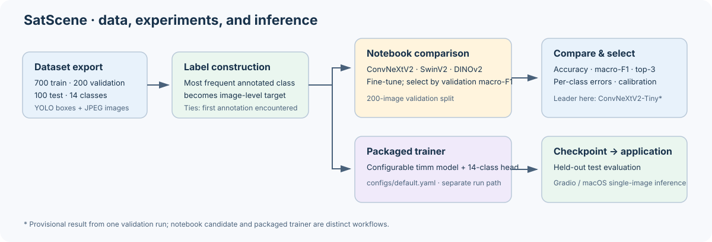
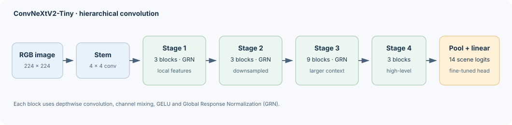
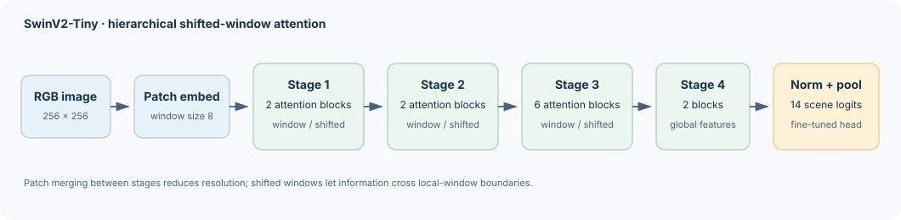
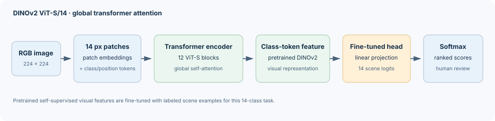
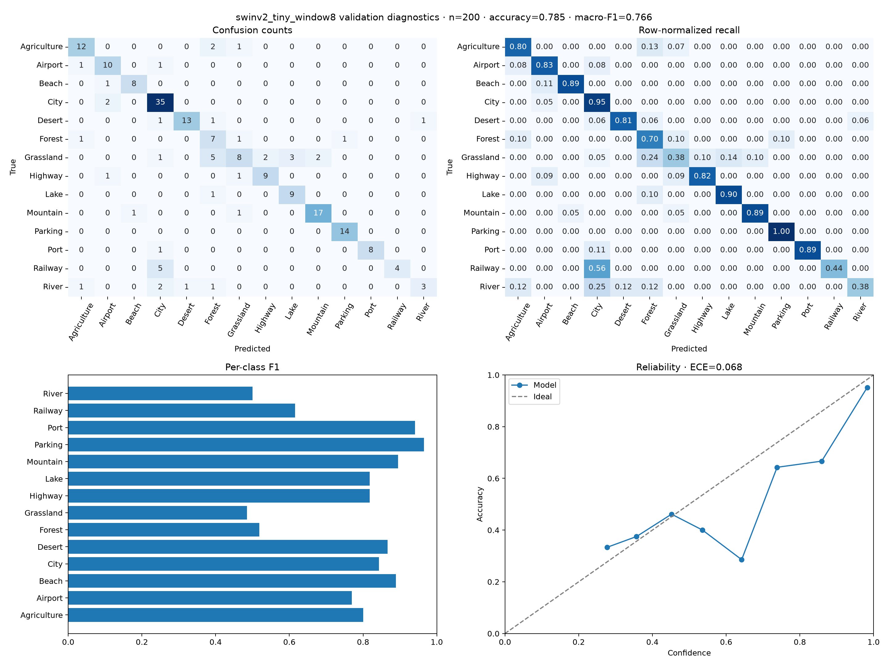
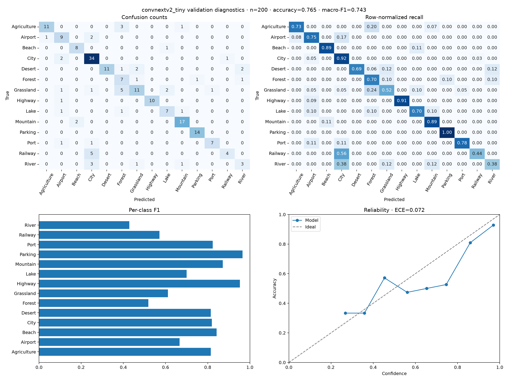
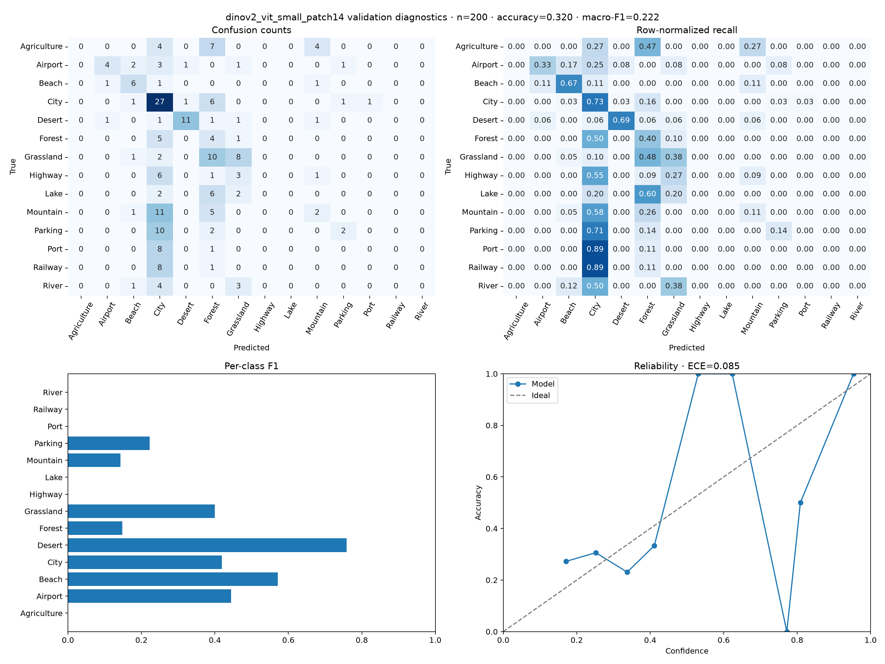
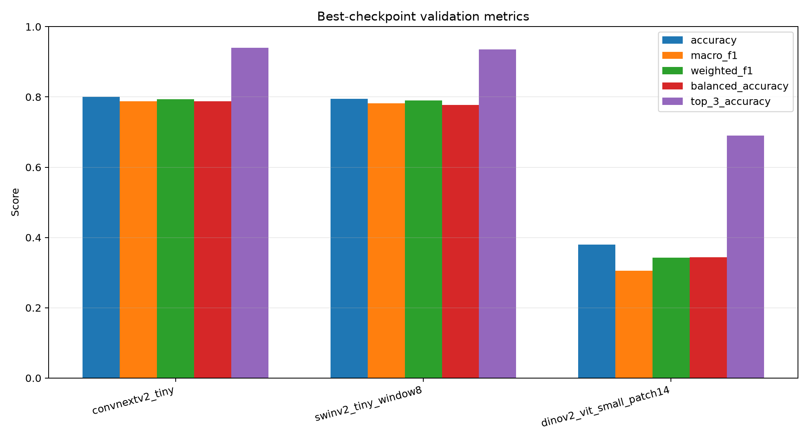
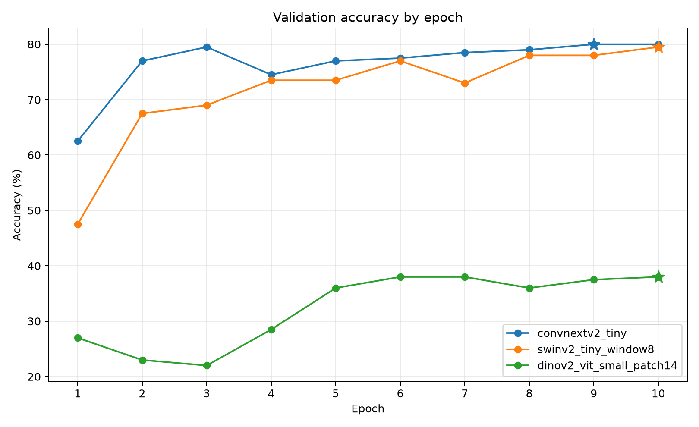
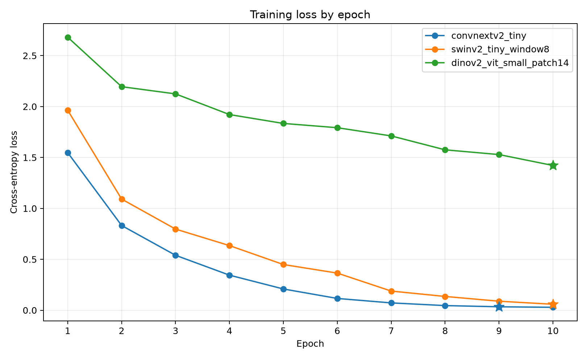

# SatScene: Satellite Scene Classification with Pretrained Vision Models

<div align="center">

**S M Gazzali Arafat Nishan**<br>
*Faculty of Computer Science, HSE University, Moscow, Russia*

<br>

[](pyproject.toml)
[](LICENSE)
[](pyproject.toml)
[](#2-dataset-and-label-construction)
[](paper/main.pdf)
[](CITATION.cff)

</div>

---

| Project metadata | Details |
| --- | --- |
| Project type | Research software prototype |
| Package | `satscene` 0.1.0 |
| Dependencies | [`pyproject.toml`](pyproject.toml), [`requirements.txt`](requirements.txt); lower bounds, no lockfile |
| Dataset | Remote Sensing Satellite Images; 1,000 RGB images, 14 classes |
| Data splits | 700 train / 200 validation / 100 test |
| Paper source | [LaTeX](paper/main.tex) |

## Abstract

SatScene is research software for image-level scene classification in overhead RGB
imagery. It converts object-detection annotations into image-level targets, fine-tunes
pretrained classifiers, evaluates selected checkpoints, and exposes ranked predictions
through local interfaces. We compare ConvNeXtV2-Tiny, SwinV2-Tiny, and DINOv2 ViT-S/14
on a 1,000-image, 14-class dataset. ConvNeXtV2-Tiny achieves 80.0% validation accuracy
and 0.788 macro-F1 in its recorded run. Each backbone was trained once with one seed;
these results do not establish a stable ranking or geographic generalization. The
repository provides the code, configurations, metrics, and documentation needed to
inspect the project-scale workflow. Exact reproduction additionally requires the
matching dataset, checkpoints, and software environment, which are not fully archived.

**Keywords —** remote sensing; satellite imagery; scene classification; transfer
learning; ConvNeXt; Swin Transformer; DINOv2; decision support

**Paper figures:** [view the figures](paper/figures/) ·
**Dataset provenance:** [source and export details](resources/README.md) ·
**Software citation:** [CITATION.cff](CITATION.cff)

## Contents

- [1. Project scope](#1-project-scope)
- [2. Dataset and label construction](#2-dataset-and-label-construction)
- [3. Methods](#3-methods)
- [3.4 Algorithm pseudocode and implementation correspondence](#34-algorithm-pseudocode-and-implementation-correspondence)
- [4. Experimental protocol](#4-experimental-protocol)
- [5. Results](#5-results)
- [6. Discussion](#6-discussion)
- [7. Limitations](#7-limitations)
- [8. Reproducibility and use](#8-reproducibility-and-use)
- [8.5 Run the applications and tests](#85-run-the-applications-and-tests)
- [9. Software and archive contents](#9-software-and-archive-contents)
- [References and licenses](#references-and-licenses)

## 1. Project scope

SatScene studies image-level land-use scene classification using a small remote-sensing
dataset. The complete workflow is: obtain and inspect the supplied data; derive
single-image targets from YOLO annotations; prepare RGB inputs; fine-tune and select
models using validation data; evaluate selected checkpoints; and expose image-level
predictions through local decision-support interfaces. The repository has two training
workflows: the notebook's three-backbone scientific comparison and the configurable
package trainer. Their settings and checkpoints are separate and should not be confused.

The supplied images are ordinary JPEGs without coordinates, a coordinate reference
system, geotransforms, or multispectral bands. SatScene therefore analyzes image
appearance only: it does not perform georeferenced raster analysis, calculate NDVI,
read elevation data, or execute the suggested follow-up analyses.

### Project contributions and scope

This repository's contribution is an integrated, inspectable workflow rather than a
new neural-network architecture or a new satellite dataset:

1. It documents the conversion from object-level YOLO labels to one image-level target,
   including the tie and missing-label rules.
2. It provides one comparable fine-tuning protocol for three pretrained backbones,
   plus a distinct configurable package trainer.
3. It records validation and test metrics, class-level diagnostics, and implementation
   references, while stating the limits of one-seed evaluation on proxy labels.
4. It connects trained classifiers to local browser and optional macOS interfaces that
   return ranked predictions and static, advisory suggestions.

The results are a project-scale baseline, not a claim of state-of-the-art performance.
The benchmark dataset and pretrained weights are third-party resources; this project
does not claim ownership of them.

### 1.1 End-to-end project pipeline

The figure follows data from the YOLO export through training, evaluation, and
single-image decision support. The notebook comparison and configured package trainer
are separate routes; their protocols are detailed in Sections 3 and 8.



The comparison notebook derives labels with the maintained YOLO parser and reports the
resulting class distributions. Each model has one saved run, so the results do not measure
variation across seeds. Checkpoints were selected on validation data and then evaluated
on the test split. Those test results are now reported below; the split has been used and
must not be reused for model selection. The class suggestion is static decision support,
not an automated GIS analysis.

## 2. Dataset and label construction

The source is the [Remote Sensing Satellite Images dataset on Kaggle](https://www.kaggle.com/datasets/umeradnaan/remote-sensing-satellite-images),
distributed in a [Roboflow YOLOv8 export](https://universe.roboflow.com/image-captioning-for-remote-sensingdata-0zids/remote-sensing-data/dataset/2).
The export contains 1,000 images in supplied train, validation, and test splits
(700/200/100) and 14 classes:

> Agriculture · Airport · Beach · City · Desert · Forest · Grassland · Highway · Lake ·
> Mountain · Parking · Port · Railway · River

The export annotations are object detections rather than scene labels [20]. For each image,
the implementation chooses the most frequent class ID in its YOLO annotation file;
ties go to the class appearing first. Images with missing or empty annotation files are
skipped. This provides a single-label classification target, but the dominant detected
object is only a proxy for the overall scene.

The training split is imbalanced: the recorded distribution ranges from 118 City images
to 17 River images (6.9:1). The dataset is not included in Git. Roboflow export metadata
reports CC BY 4.0, but the provenance and license of the underlying imagery have not
been independently verified. Check source records and permissions before reuse or
redistribution at the [dataset export](https://universe.roboflow.com/image-captioning-for-remote-sensingdata-0zids/remote-sensing-data/dataset/2).
Dataset provenance is also recorded in
[`resources/dataset_source.txt`](resources/dataset_source.txt).

An automatic audit of the supplied labels found multiple object classes in 101
training, 27 validation, and 6 test images. The most frequent class count tied in
94, 26, and 6 images, respectively, so the first-annotation tie rule determines
many image-level targets. No image was skipped for a missing or empty label file.
A SHA-256 check found no byte-identical image files shared across the splits; it
does not rule out resized, recompressed, or geographically adjacent near-duplicates.
No manual scene-label audit has been conducted.

## 3. Methods

### 3.1 Image preparation

Images are read as RGB, resized to the model's configured square input size, and
normalized using ImageNet channel statistics. Training augmentation applies horizontal
flip, vertical flip, and random 90-degree rotation, each with probability 0.5. Validation
and evaluation use resize and normalization without random augmentation.

### 3.2 Model comparison

The comparison notebook uses the same supervised image-classification task and
fine-tuning recipe for three pretrained `timm` backbones. A fresh classification head
maps each backbone's image features to the project's 14 scene classes; the optimizer
updates the head and the pretrained backbone.

| Model | Architecture and what it contributes here | `timm` model identifier | Input |
| --- | --- | --- | ---: |
| **ConvNeXtV2-Tiny** | Hierarchical convolutional stages combine local texture with progressively larger spatial features. ConvNeXtV2 adds Global Response Normalization (GRN) to ConvNeXt blocks [2]. | `convnextv2_tiny.fcmae_ft_in1k` | 224 × 224 |
| **SwinV2-Tiny** | Hierarchical vision Transformer with local-window attention, shifted windows, and patch merging [4]. | `swinv2_tiny_window8_256.ms_in1k` | 256 × 256 |
| **DINOv2 ViT-S/14** | Global self-attention over 14 × 14-pixel patch tokens, initialized from self-supervised DINOv2 features (`lvd142m`; [6]). | `vit_small_patch14_dinov2.lvd142m` | 224 × 224 |

The DINOv2 pretrained configuration declares a 518-pixel input. The comparison
notebook constructs this model with a 224-pixel input. In the inspected `timm` 1.0.30
installation, the DINOv2 checkpoint filter resamples the learned positional embeddings
to the resulting 16 × 16 patch grid. The archived run configuration does not record
the `timm` version, so this inspection cannot establish which precise loader version
was used for that run. The input-resolution change was not evaluated as a separate
factor, so its effect on the DINOv2 result is unknown.

All three models use the same initial learning rate in the archived comparison. No
model-specific learning-rate sweep, layer-wise decay, or frozen-feature linear probe
was run. The DINOv2 score therefore describes this particular full-fine-tuning recipe,
not the architecture's general capability.

#### Architecture diagrams

These simplified diagrams show the backbone and 14-class prediction path used in
SatScene. They are original, repository-local SVG schematics based on the cited model
papers, not reproductions of the papers' figures.

**ConvNeXtV2-Tiny [2]** — hierarchical convolutional stages with GRN in the
ConvNeXtV2 blocks. The architecture builds on ConvNeXt [1].



**Swin Transformer V2-Tiny [4]** — hierarchical shifted-window attention, with
patch merging between stages; its shifted-window design follows Swin Transformer [3].



**DINOv2 ViT-S/14 [6]** — global self-attention over patch tokens, initialized
from self-supervised DINOv2 features. The Transformer patch-token formulation is
introduced in ViT [5].



#### Comparison training pipeline

```text
YOLO export + image files
  → one image label: most frequent annotated class (ties: first class encountered)
  → train/validation loaders; RGB resize + ImageNet normalization
  → train-only random horizontal/vertical flips and 90° rotations (p = 0.5 each)
  → pretrained backbone + new 14-class head
  → cross-entropy fine-tuning (AdamW, lr 3e-4, weight decay 1e-4)
  → validation after each epoch; cosine learning-rate schedule
  → save the checkpoint with the highest validation macro-F1
  → compare accuracy, macro-F1, balanced accuracy, top-3 accuracy,
    calibration, and per-class errors
```

All three saved run configurations specify seed 42, batch size 16, and 10 epochs. The
input is 224 × 224 for ConvNeXtV2 and DINOv2, and 256 × 256 for SwinV2. The augmentation and
ImageNet-normalization pipeline is shared; only resize dimensions vary. Training uses
the 700-image train split and model selection uses the 200-image validation split. The
100-image test split was not used to select these comparison checkpoints and has since
been evaluated for each saved checkpoint. See
[`src/satscene/data.py`](src/satscene/data.py) for transforms and loaders and
[`notebooks/GIS_project_original.ipynb`](notebooks/GIS_project_original.ipynb) for the
comparison training code. The notebook reports 700 labeled training images, 200 labeled
validation images, and no skipped images for those splits. The saved configurations and
epoch histories document one run per model; repeat seeds before claiming a dependable
ranking.

ConvNeXtV2 extends the modernized ConvNet design of ConvNeXt [1,2], using local
convolutions and hierarchical feature maps. SwinV2 [3,4] uses shifted-window attention
to communicate spatial context with fewer pairwise interactions than global attention
at high token counts. ViT introduced the patch-token Transformer formulation [5], and
DINOv2 supplies self-supervised visual representations [6]. These are different
inductive biases for aerial scenes, not guarantees of performance: the results below
measure these exact pretrained checkpoints under this small-data fine-tuning setup.

### 3.3 Mathematical formulation

All three comparison systems implement an image-to-class mapping. Given normalized
image $\mathbf{x}$, pretrained backbone $f_{\boldsymbol{\theta}}$, and a 14-class
linear head, the model produces logits $\mathbf{z}$ and class probabilities $\mathbf{p}$:

$$
\mathbf{h}=f_{\boldsymbol{\theta}}(\mathbf{x}),\qquad
\mathbf{z}=\mathbf{W}\mathbf{h}+\mathbf{b}\in\mathbb{R}^{14},
$$

$$
p_c=\frac{\exp(z_c)}{\sum_{j=0}^{13}\exp(z_j)},\qquad
\hat{y}=\arg\max_{c\in\{0,\ldots,13\}}p_c.
$$

For a batch of `B` labeled images, fine-tuning minimizes multiclass cross-entropy:

$$
\mathcal{L}_{\mathrm{CE}}
=-\frac{1}{B}\sum_{i=1}^{B}\log p_{i,y_i}
=\frac{1}{B}\sum_{i=1}^{B}\left[-z_{i,y_i}
+\log\!\left(\sum_{c=0}^{13}\exp(z_{i,c})\right)\right].
$$

The comparison uses AdamW [7] ($\eta=3\times10^{-4}$, weight decay $\lambda=10^{-4}$)
and cosine annealing [8] over 10 epochs. The per-epoch learning rate follows

$$
\eta_t=\eta_{\min}+\frac{\eta_0-\eta_{\min}}{2}
\left[1+\cos\!\left(\frac{\pi(t-1)}{T_{\max}}\right)\right],\qquad
t=1,\ldots,10,\quad T_{\max}=10,\quad \eta_{\min}=0.
$$

Thus the notebook starts epoch 1 at $\eta_0$ and advances the scheduler after
each epoch. The checkpoint rule is
$t^\star=\arg\max_{t\in\{1,\ldots,10\}}\mathrm{F1}_{\rm macro}
(\mathcal{D}_{\rm val};\theta_t)$; ties retain the earlier checkpoint because
the implementation saves only on a strict improvement. This is model selection
on validation data, not an unbiased estimate of generalization.

The architectures have different feature interaction costs. ConvNeXtV2 uses local
convolutions in four hierarchical stages (Tiny depths `3, 3, 9, 3`) and global
channel response normalization. SwinV2 uses self-attention within windows of $M\times M$
tokens [3,4], alternates shifted windows, and merges patches between stages. At a stage
with $N$ tokens and feature width $d$, window attention has pairwise-attention cost
approximately $\mathcal{O}(NM^2d)$, while global attention has $\mathcal{O}(N^2d)$.
DINOv2 ViT-S/14 [6] uses global attention over patch tokens: a $224\times224$
input gives $(224/14)^2=256$ patch tokens, plus one class token, for sequence
length $N=257$. Its attention interaction term scales as $\mathcal{O}(N^2d)$ per
block. These costs describe attention
interactions, not full end-to-end FLOPs; projections, MLPs, convolution, and feature
width also contribute. Full block equations, metric definitions, and derivations are
in [Mathematical foundations](docs/MATHEMATICAL_METHODS.md).

For class $c$, precision is $\mathrm{TP}_c/(\mathrm{TP}_c+\mathrm{FP}_c)$, recall is
$\mathrm{TP}_c/(\mathrm{TP}_c+\mathrm{FN}_c)$, and
$\mathrm{F1}_c=2\,\mathrm{precision}_c\,\mathrm{recall}_c/(\mathrm{precision}_c+\mathrm{recall}_c)$.
Macro-F1 is the unweighted mean of the 14 class F1 scores; balanced accuracy is the
mean class recall. The accuracy interval uses the Wilson score method [11,12]. For example,
the latest saved validation reports give ConvNeXtV2-Tiny $160/200=0.800$ accuracy
(95% Wilson CI $[0.739,0.850]$), macro-F1 $0.7881$, and balanced accuracy $0.7876$;
SwinV2-Tiny $159/200=0.795$ accuracy (CI $[0.734,0.845]$), macro-F1 $0.7817$, and
balanced accuracy $0.7770$; and DINOv2 ViT-S/14 $76/200=0.380$ accuracy
(CI $[0.316,0.449]$), macro-F1 $0.3049$, and balanced accuracy $0.3441$. ConvNeXtV2
and SwinV2 differ by one validation image ($0.005$ accuracy) and approximately $0.0063$
macro-F1. These single-run results do not establish a stable ranking. Values are from
the per-model reports in [`runs/convnextv2_tiny/metrics_valid.json`](runs/convnextv2_tiny/metrics_valid.json),
[`runs/swinv2_tiny_window8/metrics_valid.json`](runs/swinv2_tiny_window8/metrics_valid.json),
and [`runs/dinov2_vit_small_patch14/metrics_valid.json`](runs/dinov2_vit_small_patch14/metrics_valid.json).

### 3.4 Algorithm pseudocode and implementation correspondence

These four algorithms summarize the procedures shown in the paper. Algorithm 2
describes the archived notebook comparison; the command-line trainer is a related
but separate configurable implementation. Each algorithm was checked against its
source implementation as listed in the code-correspondence table below.
The pseudocode is set in display mathematics so subscripts, superscripts, fractions,
summations, and square roots render in GitHub's math view; the paper PDF contains
boxed `algorithm` floats for publication-style pagination.

#### Algorithm 1 — Convert object annotations to image labels

$$
\begin{aligned}
\textbf{Input:}\quad
  &\mathcal{X}_s,\ \text{same-stem YOLO labels},\
    \mathcal{C}=\{0,\ldots,13\}.\\
\textbf{Output:}\quad
  &\mathcal{D}_s,\ \mathcal{S}_s.\\
\textbf{1.}\quad
  &\mathcal{D}_s\gets\varnothing,\quad\mathcal{S}_s\gets\varnothing.\\
\textbf{2.}\quad
  &\textbf{for }x_i\in\mathrm{sort}_{\rm lex}(\mathcal{X}_s)\textbf{ do}\\
\textbf{3.}\quad
  &\quad a_i\gets(a_{i1},\ldots,a_{iJ_i})
    \quad\text{from the matching label file}.\\
\textbf{4.}\quad
  &\quad\textbf{if the file is absent or }J_i=0\textbf{ then}\\
\textbf{5.}\quad
  &\qquad\mathcal{S}_s\gets\mathcal{S}_s\cup\{x_i\};
    \quad\textbf{continue}.\\
\textbf{6.}\quad
  &\quad n_{ic}\gets\sum_{j=1}^{J_i}\mathbb{1}[a_{ij}=c],
    \quad\forall c\in\mathcal{C}.\\
\textbf{7.}\quad
  &\quad m_i\gets\max_{c\in\mathcal{C}}n_{ic}.\\
\textbf{8.}\quad
  &\quad j_i^\star\gets
    \min\{j\in\{1,\ldots,J_i\}:n_{i,a_{ij}}=m_i\}.\\
\textbf{9.}\quad
  &\quad y_i\gets a_{i,j_i^\star},\quad
    \mathcal{D}_s\gets\mathcal{D}_s\cup\{(x_i,y_i)\}.\\
\textbf{10.}\quad
  &\textbf{return }(\mathcal{D}_s,\mathcal{S}_s).
\end{aligned}
$$

The tie rule is order-sensitive by design: among equally frequent labels, the
first class encountered in the annotation file wins. Box coordinates are parsed
as part of the YOLO row but are not used in the image-level target.

#### Algorithm 2 — Fine-tune and select a checkpoint

$$
\begin{aligned}
\textbf{Input:}\quad
  &\mathcal{D}_{\rm tr},\mathcal{D}_{\rm va},\
    \text{pretrained backbone }m,\ E=10,\ B=16,\ \text{seed}=42.\\
\textbf{Output:}\quad
  &\theta^\star,\ t^\star,\ \mathcal{H}.\\
\textbf{1.}\quad
  &\text{Set Python, NumPy, and PyTorch seeds to }42;\
    \theta\gets(\theta_m,\theta_{\rm head})\text{ from pretrained }m
    \text{ and a 14-class head};\quad\mathcal{H}\gets\varnothing.\\
\textbf{2.}\quad
  &\text{Initialize cross-entropy and AdamW }(\eta_0=3\cdot10^{-4},
    \lambda=10^{-4});\quad F^\star\gets-\infty.\\
\textbf{3.}\quad
  &\textbf{for }t=1,\ldots,E\textbf{ do}\\
\textbf{4.}\quad
  &\quad\eta_t\gets\eta_{\min}
    +\frac{\eta_0-\eta_{\min}}{2}
      \left[1+\cos\left(\frac{\pi(t-1)}{E}\right)\right],
    \quad\eta_{\min}=0.\\
\textbf{5.}\quad
  &\quad\text{Shuffle }\mathcal{D}_{\rm tr}\text{ and partition into batches }
    \mathcal{B}_t\text{ of size }B.\\
\textbf{6.}\quad
  &\quad\textbf{for }(X,Y)\in\mathcal{B}_t\textbf{ do}\\
\textbf{7.}\quad
  &\qquad\widetilde X\gets\mathcal{A}(X);
    \ \mathcal{A}\text{ applies horizontal flip, vertical flip, and }90^\circ
    \text{ rotation independently with probability }0.5.\\
\textbf{8.}\quad
  &\qquad\text{Resize to }224,\ 256,\text{ or }224
    \text{ pixels for ConvNeXtV2, SwinV2, or DINOv2; ImageNet-normalize}.\\
\textbf{9.}\quad
  &\qquad p_{ic}\gets\mathrm{softmax}(f_\theta(\widetilde x_i))_c,
    \quad
    \mathcal{L}\gets-\frac{1}{|Y|}
      \sum_{i=1}^{|Y|}\log p_{i,y_i}.\\
\textbf{10.}\quad
  &\qquad\theta\gets
    \mathrm{AdamWStep}(\theta,\nabla_\theta\mathcal{L},
      \eta_t,\lambda).\\
\textbf{11.}\quad
  &\quad\textbf{end for}.\\
\textbf{12.}\quad
  &\quad\text{Evaluate }\mathcal{D}_{\rm va}\text{ without augmentation};
    \quad
    F_t\gets\frac{1}{14}\sum_{c=0}^{13}
      \frac{2P_{t,c}R_{t,c}}{P_{t,c}+R_{t,c}},\\
  &\qquad\text{where }P_{t,c},R_{t,c}\text{ are validation precision and recall
    (zero if the denominator is zero).}\\
\textbf{13.}\quad
  &\quad\textbf{if }F_t>F^\star\textbf{ then }
    (F^\star,\theta^\star,t^\star)\gets
      (F_t,\mathrm{copy}(\theta),t);
    \quad\text{save }\theta^\star.\\
\textbf{14.}\quad
  &\quad\mathcal{H}\gets\mathcal{H}\cup
    \{\text{epoch losses and validation metrics}\};
    \quad\text{advance cosine scheduler}.\\
\textbf{15.}\quad
  &\textbf{end for}.\\
\textbf{16.}\quad
  &\textbf{return }(\theta^\star,t^\star,\mathcal{H}).
\end{aligned}
$$

For optimizer step $r$, the AdamW state and decoupled weight-decay update are

$$
\begin{aligned}
g_r&=\nabla_\theta\mathcal{L}_r,&
m_r&=\beta_1m_{r-1}+(1-\beta_1)g_r,&
v_r&=\beta_2v_{r-1}+(1-\beta_2)g_r^{\odot2},\\
\widehat m_r&=\frac{m_r}{1-\beta_1^r},&
\widehat v_r&=\frac{v_r}{1-\beta_2^r},&
\theta_r&=(1-\eta_t\lambda)\theta_{r-1}
-\eta_t\frac{\widehat m_r}{\sqrt{\widehat v_r}+\epsilon}.
\end{aligned}
$$

The notebook uses PyTorch AdamW defaults
$(\beta_1,\beta_2,\epsilon)=(0.9,0.999,10^{-8})$. It resets the random seed
for each model and fine-tunes the complete backbone and classification head.
The best observed epochs are 9 for ConvNeXtV2-Tiny and 10 for SwinV2-Tiny
and DINOv2 ViT-S/14.

#### Algorithm 3 — Evaluate a selected checkpoint

$$
\begin{aligned}
\textbf{Input:}\quad
  &\theta^\star,\quad
    \mathcal{D}_{\rm te}=\{(x_i,y_i)\}_{i=1}^{N},\quad C=14.\\
\textbf{Output:}\quad
  &\text{predictions, metrics, and diagnostic artifacts}.\\
\textbf{1.}\quad
  &\textbf{for }(x_i,y_i)\in\mathcal{D}_{\rm te}\textbf{ do, without gradients}\\
\textbf{2.}\quad
  &\quad p_i\gets\mathrm{softmax}(f_{\theta^\star}(x_i)),\quad
    \widehat y_i\gets\arg\max_c p_{ic}.\\
\textbf{3.}\quad
  &\quad T_i\gets\mathrm{Top3}(p_i),\quad
    q_i\gets\max_c p_{ic},\quad
    r_i\gets\mathbb{1}[\widehat y_i=y_i].\\
\textbf{4.}\quad
  &\textbf{end for}.\\
\textbf{5.}\quad
  &M_{ab}\gets\sum_{i=1}^{N}
    \mathbb{1}[y_i=a,\widehat y_i=b],\quad
    A\gets\frac{1}{N}\sum_{i=1}^{N}r_i.\\
\textbf{6.}\quad
  &\text{Compute per-class precision, recall, F1, and support; macro-F1,
    balanced accuracy, and }\mathrm{Acc}@3.\\
\textbf{7.}\quad
  &\text{Compute NLL, multiclass Brier score, and ten-bin top-label ECE
    from }\{p_i,y_i\}_{i=1}^{N}.\\
\textbf{8.}\quad
  &\text{Compute the 95\% Wilson score interval for }A.\\
\textbf{9.}\quad
  &\text{Save per-image predictions, JSON metrics, and confusion/reliability
    diagnostics}.\\
\textbf{10.}\quad
  &\textbf{return evaluation outputs; do not use test results to select or tune }
    \theta^\star.
\end{aligned}
$$

The implemented probability metrics are

$$
\begin{aligned}
\mathrm{NLL}
&=-\frac1N\sum_{i=1}^N\log p_{i,y_i},\\
\mathrm{Brier}
&=\frac1N\sum_{i=1}^N\sum_{c=1}^{C}
\left(p_{ic}-\mathbb{1}[y_i=c]\right)^2,\\
\mathrm{ECE}
&=\sum_{m=1}^{10}\frac{|B_m|}{N}
\left|\mathrm{acc}(B_m)-\mathrm{conf}(B_m)\right|.
\end{aligned}
$$

Here $B_m$ are ten equal-width bins of top-label confidence; empty bins are
omitted. For observed accuracy $\widehat p=k/N$, $z=1.96$, and
$d=1+z^2/N$, the Wilson interval is

$$
\frac{\widehat p+z^2/(2N)}{d}
\ \pm\
\frac{z}{d}\sqrt{\frac{\widehat p(1-\widehat p)}{N}
+\frac{z^2}{4N^2}}.
$$

#### Algorithm 4 — Single-image prediction and decision support

$$
\begin{aligned}
\textbf{Input:}\quad
  &\text{RGB image }x,\ \theta^\star,\ \mathcal{C},\
    \mathcal{K},\ \tau=0.5.\\
\textbf{Output:}\quad
  &R=(\widehat c,q,\mathcal{T}_K,u,v,b).\\
\textbf{1.}\quad
  &\widetilde x\gets
    \mathrm{Normalize}(\mathrm{Resize}(\mathrm{RGB}(x)));
    \quad\text{use checkpoint input size and ImageNet statistics}.\\
\textbf{2.}\quad
  &p\gets\mathrm{softmax}(f_{\theta^\star}(\widetilde x)).\\
\textbf{3.}\quad
  &(c_1,\ldots,c_K)\gets
    \mathrm{argsort}_{c\in\mathcal{C}}(p_c)\text{ in descending order},
    \quad K=\min(3,|\mathcal{C}|).\\
\textbf{4.}\quad
  &\widehat c\gets c_1,\quad q\gets p_{\widehat c},\quad
    \mathcal{T}_K\gets\{(c_j,p_{c_j})\}_{j=1}^{K}.\\
\textbf{5.}\quad
  &(u,v)\gets\mathcal{K}(\widehat c),\quad
    b\gets\mathbb{1}[q<\tau].\\
\textbf{6.}\quad
  &\textbf{return }R;
    \quad(u,v)\text{ are static advisory text, not executed GIS actions}.
\end{aligned}
$$

The suggestion is a static lookup for an analyst. The interface does not
retrieve geospatial data or execute GIS operations.

#### Does the code implement these algorithms?

| Algorithm | Implementation evidence | Verified behavior |
| --- | --- | --- |
| 1. Image-label construction | [`src/satscene/labels.py`](src/satscene/labels.py): `parse_yolo_label`, `collect_split` | Counts object class IDs, selects the most frequent, breaks ties by first occurrence, sorts image paths, and records missing/empty labels as skipped. |
| 2. Three-model comparison | [`notebooks/GIS_project_original.ipynb`](notebooks/GIS_project_original.ipynb): `train_one_model`, `evaluate_epoch` | Seeds each run; uses cross-entropy, AdamW, cosine scheduling, validation macro-F1 selection, and saves the best checkpoint. Saved configs confirm the three model names, image sizes, seed, batch size, epoch count, and optimizer settings. |
| 2. Packaged trainer (separate workflow) | [`src/satscene/train.py`](src/satscene/train.py): `main`, `evaluate_loader`, `build_lr_scheduler` | Implements configurable training with the default ConvNeXt-Tiny configuration; supports optional focal/class-weighted loss, separate backbone/head learning rates, warm-up, and early stopping. These options are not the archived three-model protocol. |
| 3. Checkpoint evaluation | [`src/satscene/evaluate.py`](src/satscene/evaluate.py): `_evaluate_checkpoint` | Calculates confusion counts, class and aggregate scores, top-3, NLL, Brier, ECE, Wilson interval; writes per-image CSV, JSON metrics, and diagnostics. |
| 4. Inference and reporting | [`src/satscene/agent.py`](src/satscene/agent.py): `SatelliteAgent.perceive`, `analyze_structured`; [`src/satscene/knowledge.py`](src/satscene/knowledge.py) | Applies checkpoint-sized inference preprocessing, returns top-$k$ softmax predictions, static knowledge lookup, and a flag when top-1 confidence is below 0.5. |

This correspondence was verified by reading these functions and comparing their
behavior and archived run settings with the pseudocode above. The package trainer
and the notebook experiment share components such as the label parser and model
factory, but they are not the same training run.

#### Additional model mathematics

The following integrals are continuous-field analogies; the implemented networks
operate on sampled image tensors, finite kernels, and finite token sequences.
For a normalized RGB field $X_i:\Omega\to\mathbb{R}^3$, a convolutional
operator can be written

$$
H_c(\mathbf{u})=b_c+\sum_{q=1}^3
\int_{\mathbb{R}^2}K_{cq}(\boldsymbol\delta)
X_{i,q}(\mathbf{u}-\boldsymbol\delta)\,d\boldsymbol\delta,
\qquad
H_{c,r,s}=b_c+\sum_q\sum_{a,b}K_{cq,a,b}X_{q,r-a,s-b}.
$$

For layer $\ell$, receptive-field width $R_\ell$ and input-pixel jump $j_\ell$
obey
$j_\ell=j_{\ell-1}s_\ell$ and
$R_\ell=R_{\ell-1}+(k_\ell-1)j_{\ell-1}$, with
$R_0=j_0=1$, kernel width $k_\ell$, and stride $s_\ell$. ConvNeXtV2's
global-response normalization uses feature-map sums in code; its continuous
analogue is

$$
G_c=\left(\int_{\Omega}|H_c(\mathbf{u})|^2\,d\mathbf{u}\right)^{1/2},
\quad n_c=\frac{G_c}{D^{-1}\sum_{d=1}^{D}G_d+\epsilon},
\quad \widetilde H_{c,r,s}=H_{c,r,s}+\gamma_cH_{c,r,s}n_c+\beta_c,
\quad D=\text{number of feature channels}.
$$

Likewise, global average pooling is the grid approximation to
$h_c=|\Omega|^{-1}\int_\Omega H_c(\mathbf{u})\,d\mathbf{u}$.
For Transformer tokens $X\in\mathbb{R}^{N\times d}$, attention is a finite
weighted sum:

$$
Q=XW_Q,\quad K=XW_K,\quad V=XW_V,\quad
\alpha_{ij}=\frac{\exp(q_i^\top k_j/\sqrt{d_k})}
{\sum_{r=1}^N\exp(q_i^\top k_r/\sqrt{d_k})},\quad
o_i=\sum_{j=1}^{N}\alpha_{ij}v_j.
$$

Its continuous interpretation is
$o(\mathbf{u})=\int_\Omega a(\mathbf{u},\mathbf{v})V(\mathbf{v})\,d\mathbf{v}$,
where $\int_\Omega a(\mathbf{u},\mathbf{v})\,d\mathbf{v}=1$; this integral is
an analogy, not a numerical operation in the implementation. For a class logit
$z_{ij}$ and one-hot target $y_{ij}=\mathbb{1}[y_i=j]$, cross-entropy gives

$$
\frac{\partial \ell_i}{\partial z_{ij}}=p_{ij}-y_{ij},\qquad
\nabla_W\mathcal{L}=\frac1B\sum_{i=1}^{B}
(\mathbf{p}_i-\mathbf{y}_i)\mathbf{h}_i^\top.
$$

Further block-level derivations for GELU, SwinV2 scaled-cosine attention,
Transformer residual blocks, empirical risk, optimization, and evaluation are
in [`docs/MATHEMATICAL_METHODS.md`](docs/MATHEMATICAL_METHODS.md) and
[`paper/main.tex`](paper/main.tex).

### 3.5 Improving the method for this task

The current experiment is a useful baseline, but the dataset size and label construction
limit what can be learned reliably. The next improvements should target those constraints:

1. **Audit the scene labels.** The dominant YOLO object is an imperfect proxy for the
   whole image. Review ambiguous and multi-class scenes, correct noisy labels, and record
   label confidence before spending compute on larger models.
2. **Measure variance.** Repeat training with several seeds and report mean and spread
   for macro-F1 and balanced accuracy. The one-image difference between ConvNeXtV2 and
   SwinV2 on this validation set is too small to establish a dependable winner.
3. **Address minority classes with training-only methods.** Compare class-weighted loss
   or a balanced sampler, and use label-preserving rotations/crops suited to overhead
   imagery. Select settings on validation data and report per-class recall to check that
   gains are not limited to frequent classes.
4. **Use spatially independent evaluation when locations are available.** Random image
   splits can place nearby or near-duplicate scenes in both training and validation.
   Group by location, source tile, or acquisition where metadata permits, then keep a
   final test set untouched until model selection is complete.
5. **Tune the strongest candidates consistently.** Compare frozen-backbone warm-up,
   discriminative learning rates, weight decay, and input resolution for ConvNeXtV2 and
   SwinV2 under the same repeated-seed protocol. Add DINOv2 back only after verifying
   its optimization and input pipeline; its current run is much weaker, but one run
   does not diagnose the cause.
6. **Calibrate and review errors.** Fit a calibration method on validation predictions,
   inspect confusion pairs such as Forest/Grassland/River, and use an abstain/review
   threshold when confidence is low. The current softmax score is not a guarantee of
   correctness.

These are proposed experiments, not implemented capabilities or measured improvements.
Because the supplied JPEGs lack coordinates and acquisition metadata, spatial validation
and geospatial measurements require a better documented dataset.

### 3.6 Prediction and decision support

For an input image, the classifier returns softmax scores for the 14 classes. The
rule-based reporting layer presents the top predictions, flags low top-1 confidence,
and looks up a static suggestion associated with the predicted class. Suggestions are
for an analyst; the application does not carry them out.

## 4. Experimental protocol

The saved architecture-comparison artifacts use the validation split ($n=200$) for
model selection and comparison. Each model has one recorded run and no estimate of
variation across random seeds. Accuracy intervals below are 95% Wilson score intervals; they
describe binomial sampling uncertainty for the validation sample, not variation from
retraining. The intervals overlap, so the small lead between the top two models should
not be treated as evidence of a statistically reliable difference. The notebook's
maintained label parser and saved class-distribution output agree; the main uncertainty
is the one-seed experiment and small validation sample.

Each comparison checkpoint was selected using validation data and then evaluated on
the 100-image test split. These per-model test results are reported separately below;
the test split was not used for checkpoint selection, but is no longer an unseen set and
must not be used for further model selection or tuning.

## 5. Results

### 5.1 Validation comparison

| Model | Accuracy (95% Wilson CI) | Macro-F1 | Balanced accuracy | Weighted F1 | Top-3 | NLL | Brier | ECE |
| --- | ---: | ---: | ---: | ---: | ---: | ---: | ---: | ---: |
| **ConvNeXtV2-Tiny** | **80.0% (73.9–85.0%)** | **0.788** | **0.788** | **0.793** | **94.0%** | **0.780** | **0.319** | 0.118 |
| SwinV2-Tiny | 79.5% (73.4–84.5%) | 0.782 | 0.777 | 0.790 | 93.5% | 1.037 | 0.343 | 0.129 |
| DINOv2 ViT-S/14 | 38.0% (31.6–44.9%) | 0.305 | 0.344 | 0.342 | 69.0% | 1.874 | 0.749 | **0.103** |

ECE is expected calibration error [10] (lower is better, but it does not measure
classification quality by itself). ConvNeXtV2 is the best choice **among these three
recorded validation runs**: it has the highest macro-F1, accuracy, balanced accuracy,
weighted F1, and top-3 accuracy. Its margin over SwinV2 is small (one more correct
validation image and 0.006 higher macro-F1), and the accuracy intervals overlap. DINOv2
has the lowest ECE, but its much lower classification scores make it the weakest
predictor overall here.

The complete aggregate metrics are in
[`runs/model_comparison_metrics.csv`](runs/model_comparison_metrics.csv). Each model
folder contains its exact run configuration, per-image predictions, per-class report,
confusion matrices, and calibration diagnostics.

### 5.2 Model-level diagnostics

<details>
<summary><strong>SwinV2-Tiny</strong> — close second on validation macro-F1</summary>



[Full metrics](runs/swinv2_tiny_window8/metrics_valid.json) ·
[Per-image predictions](runs/swinv2_tiny_window8/predictions_valid.csv) ·
[Run configuration](runs/swinv2_tiny_window8/config.json)

</details>

<details>
<summary><strong>ConvNeXtV2-Tiny</strong> — best overall validation scores</summary>



[Full metrics](runs/convnextv2_tiny/metrics_valid.json) ·
[Per-image predictions](runs/convnextv2_tiny/predictions_valid.csv) ·
[Run configuration](runs/convnextv2_tiny/config.json)

</details>

<details>
<summary><strong>DINOv2 ViT-S/14</strong></summary>



[Full metrics](runs/dinov2_vit_small_patch14/metrics_valid.json) ·
[Per-image predictions](runs/dinov2_vit_small_patch14/predictions_valid.csv) ·
[Run configuration](runs/dinov2_vit_small_patch14/config.json)

</details>

### 5.3 Per-class performance of SwinV2-Tiny

The per-class F1 results show why the macro-average and class support matter. SwinV2
performed strongly on several classes, while Grassland, Forest, and River remained
difficult.

| Class | Support | Precision | Recall | F1 |
| --- | ---: | ---: | ---: | ---: |
| Agriculture | 15 | 0.800 | 0.800 | 0.800 |
| Airport | 12 | 0.769 | 0.833 | 0.800 |
| Beach | 9 | 0.889 | 0.889 | 0.889 |
| City | 37 | 0.767 | 0.892 | 0.825 |
| Desert | 16 | 1.000 | 0.750 | 0.857 |
| Forest | 10 | 0.600 | 0.600 | 0.600 |
| Grassland | 21 | 0.647 | 0.524 | 0.579 |
| Highway | 11 | 0.769 | 0.909 | 0.833 |
| Lake | 10 | 0.750 | 0.900 | 0.818 |
| Mountain | 19 | 0.857 | 0.947 | 0.900 |
| Parking | 14 | 0.933 | 1.000 | 0.966 |
| Port | 9 | 1.000 | 0.667 | 0.800 |
| Railway | 9 | 0.750 | 0.667 | 0.706 |
| River | 8 | 0.667 | 0.500 | 0.571 |

Values are transcribed from
[`runs/swinv2_tiny_window8/metrics_valid.json`](runs/swinv2_tiny_window8/metrics_valid.json);
per-class scores are sensitive to the small number of examples in each class.

### 5.4 Comparison figures







The saved training losses fall from epoch 1 to epoch 10 for all three models:
ConvNeXtV2-Tiny $1.548\to0.029$, SwinV2-Tiny $1.964\to0.058$, and DINOv2
ViT-S/14 $2.681\to1.421$. At the validation-selected checkpoints, the
training/validation cross-entropies are $0.034/0.780$, $0.058/1.037$, and
$1.421/1.874$, respectively. The loss gap for the two stronger runs is
consistent with a train--validation disparity; these ten-epoch curves do not
show that further training would improve held-out performance. Recorded run
durations depend on the machine and should not be read as a hardware-independent
speed benchmark.

### 5.5 Held-out test evaluation

Each checkpoint was selected on validation data, then evaluated on the same 100-image
test split. These are one-run results; the test split has now been inspected and is not
a blind set for further model selection.

| Model | Accuracy (95% Wilson CI) | Macro-F1 | Balanced accuracy | Weighted F1 | Top-3 | NLL | Brier | ECE |
| --- | ---: | ---: | ---: | ---: | ---: | ---: | ---: | ---: |
| ConvNeXtV2-Tiny | **86.0% (77.9–91.5%)** | **0.783** | **0.777** | **0.866** | 95.0% | **0.545** | **0.220** | **0.059** |
| SwinV2-Tiny | 80.0% (71.1–86.7%) | 0.758 | 0.742 | 0.808 | 95.0% | 0.805 | 0.301 | 0.132 |
| DINOv2 ViT-S/14 | 41.0% (31.9–50.8%) | 0.340 | 0.355 | 0.399 | 71.0% | 1.729 | 0.690 | 0.148 |

On the same test images, ConvNeXtV2 was correct where SwinV2 was wrong on 8
images, while SwinV2 was correct where ConvNeXtV2 was wrong on 2. The exact
two-sided McNemar test gives $p=0.109$ for these 10 discordant pairs. This
paired result describes this one test split; it does not measure variability
across training seeds.

Full test metrics, per-image predictions, and confusion plots are in the corresponding
[`runs/convnextv2_tiny/`](runs/convnextv2_tiny/),
[`runs/swinv2_tiny_window8/`](runs/swinv2_tiny_window8/), and
[`runs/dinov2_vit_small_patch14/`](runs/dinov2_vit_small_patch14/) folders. The sample
evaluation in [`iodata/sample_output/`](iodata/sample_output/) matches the ConvNeXtV2-Tiny
test metrics.

## 6. Discussion

Within this single validation comparison, ConvNeXtV2-Tiny ranked first on macro-F1,
top-1 accuracy, balanced accuracy, weighted F1, and top-3 accuracy; SwinV2-Tiny was a
close second. The practical choice for this project is therefore ConvNeXtV2-Tiny if
choosing only from these validation runs. This is a provisional model-selection result,
not a claim that ConvNeXtV2 is inherently superior: the runs share one seed, the
validation sample is small, and no repeated-seed uncertainty is available. DINOv2
ViT-S/14 performed substantially worse under the recorded fine-tuning setup, despite
its large self-supervised pretraining.

The archived per-class report shows high validation F1 for Parking, Port, Beach, and
Mountain, but lower F1 for Grassland, Forest, and River. Small class supports make these
estimates uncertain. The archived comparison should be interpreted as one run per model,
not as a stable ranking. The test results likewise cover one run per model and one
100-image split; repeated seeds and evaluation on a new independent test set are needed
before making broader performance claims.

Related EuroSAT studies examine deep-learning classifiers and compare pretrained
ResNet and GoogLeNet variants [21], [22]. They provide useful context for satellite
scene classification, but their ten-class EuroSAT data, label definitions, and
evaluation protocols differ from SatScene's 14-class, proxy-labeled RGB dataset.
Their reported results therefore should not be compared numerically with the
validation results in this repository.

### Conclusion

SatScene demonstrates a complete, inspectable workflow for converting object
annotations into scene-classification targets, comparing three pretrained models,
evaluating their errors, and presenting predictions locally. ConvNeXtV2-Tiny is the
strongest of the three recorded validation runs, but a single seed and a small,
proxy-labeled dataset are insufficient to establish a dependable ranking or
geographic generalization. The most useful next steps are label auditing,
repeated-seed experiments, and evaluation on a new spatially independent test set.

## 7. Limitations

- **Single comparison run:** there are no repeated seeds or variance estimates.
- **Small, imbalanced dataset:** 1,000 images are few for a 14-class task, and class
  supports range from 8 to 37 in validation.
- **Proxy labels:** assigning the most frequent detection class as the scene label can
  misrepresent mixed or multi-object scenes.
- **No geospatial metadata:** spatial splits, geographic generalization, and actual GIS
  measurements cannot be evaluated with these JPEGs.
- **Dataset and model provenance:** dataset redistribution and pretrained-weight terms
  are external to this code license and must be checked independently.
- **Single test evaluation:** all three checkpoints have test metrics, but the supplied
  test split has now been evaluated and must not be used for further tuning or treated
  as an unseen final assessment.

The validation split is small and is reused for checkpoint and model selection. The
comparison has one recorded seed per model, so it does not quantify run-to-run variation.
The test reports are available for each comparison checkpoint under `runs/`; evaluate
future model changes on a fresh, independent test set.

## 8. Reproducibility and use

### 8.1 Environment

Requires Python 3.10 or later; Python 3.11 is recommended. From the repository root:

```bash
python3 -m venv .venv
source .venv/bin/activate
python -m pip install --upgrade pip
python -m pip install -r requirements.txt
python -m pip install -e '.[dev]'
```

The editable install exposes the `satscene` package to Python and installs the
development extra (`pytest`). `requirements.txt` also includes the Kaggle CLI used
by the optional dataset-download script.

The manifests specify minimum dependency versions rather than a fully locked
environment, and no lockfile is committed. Dependency resolution and downloaded
pretrained weights may therefore change over time. For new experiments, record the
exact Python, PyTorch, `timm`, and accelerator versions with the run configuration.

### 8.2 Dataset setup

The dataset is not tracked in the repository. Configure Kaggle CLI credentials, then
download and extract it. The script expects `~/.kaggle/kaggle.json` or
`KAGGLE_USERNAME` and `KAGGLE_KEY`:

```bash
bash scripts/download_data.sh
```

The configured directory is `data/Remote Sensing Data.v2i.yolov8`, containing
`data.yaml` and `train`, `valid`, and `test` subdirectories, each with matching
`images/` and `labels/` folders. Check the extracted path before training; change
`data.root` in [`configs/default.yaml`](configs/default.yaml) if it differs.
The label reader reports and skips images with missing or empty YOLO files.

The unit tests use temporary files and synthetic inputs, so they can be run before
downloading the dataset.

### 8.3 Train and evaluate the packaged ConvNeXt-Tiny pipeline

This is the configurable **package-training workflow**, not a rerun of the archived
three-model comparison. The default configuration uses seed 42, ConvNeXt-Tiny,
224-pixel inputs, batch size 32, 10 epochs, cross-entropy, AdamW, cosine decay, and
validation macro-F1 checkpoint selection. Class weighting, balanced sampling, focal
loss, different learning rates, warm-up, and early stopping are configurable options;
they are disabled in the default configuration.

```bash
python -m satscene.train --config configs/default.yaml
```

Training writes `config.yaml`, `history.json`, and `best_model.pth` to
`runs/convnext_tiny/`. Evaluate on validation first, and use test once only after the
model and settings are fixed:

```bash
python -m satscene.evaluate --config configs/default.yaml --split valid
python -m satscene.evaluate --config configs/default.yaml --split test
```

Evaluation writes `metrics_<split>.json`, `predictions_<split>.csv`, and
`confusion_<split>.png` beside the checkpoint. Prediction CSV image paths are
relative to the configured dataset root, so they do not disclose the machine's
local directory structure. The reported comparison test split
has already been inspected; do not use it to tune the package model or other future
candidates. For final assessment of new work, collect a fresh independent test set.

To run a separate ConvNeXtV2 fine-tuning candidate based on the comparison model, use
[`configs/convnextv2_finetune.yaml`](configs/convnextv2_finetune.yaml):

```bash
python -m satscene.train --config configs/convnextv2_finetune.yaml
```

It uses separate backbone and head learning rates, one warm-up epoch, cosine decay,
validation-accuracy checkpoint selection, and early stopping. It writes to
`runs/convnextv2_lr_tune/`, keeping the archived comparison outputs intact. Treat it as
a separate experiment; do not compare it as if it used the three-model notebook protocol.

### 8.4 Reproduce the three-model comparison

The archived comparison is in
[`notebooks/GIS_project_original.ipynb`](notebooks/GIS_project_original.ipynb). Run it
with a Jupyter kernel using the activated project environment, after setting its project
root and data path to the local checkout. It trains ConvNeXtV2-Tiny, SwinV2-Tiny, and
DINOv2 ViT-S/14 with seed 42, batch size 16, 10 epochs, and selects checkpoints by
validation macro-F1. It imports the maintained parser from `src/satscene/labels.py`.
The comparison checkpoints are stored under their respective `runs/` folders locally
but are excluded from Git due to file size. Running the notebook again writes to those
run folders; preserve or back up archived artifacts first if you need them.

To assess variability, repeat all backbones over several seeds and report means and
spread. Do not select or tune a model on the already-inspected test predictions.

### 8.5 Run the applications and tests

```bash
# Local browser interface; open http://127.0.0.1:7860
python -m satscene.app --config configs/default.yaml

# Optional: compare three locally available checkpoints in one image upload UI
python -m satscene.app --config configs/default.yaml \
  --compare-checkpoints \
  runs/convnextv2_tiny/best_model.pth \
  runs/swinv2_tiny_window8/best_model.pth \
  runs/dinov2_vit_small_patch14/best_model.pth

# Optional native macOS interface
python -m satscene.desktop --config configs/default.yaml

# Complete unit test suite
python -m pytest -q

# One test module or verbose test names
python -m pytest -q tests/test_labels.py
python -m pytest -v
```

The suite contains 22 tests for label parsing, metric helpers, evaluation argument
handling, knowledge lookup, and browser/native application behavior. Verified in this
worktree with `.venv/bin/python -m pytest -q`: **22 passed**. It does not need the
training dataset or model weights. Run it from the repository root with the project
environment activated; a system Python without the development extra will report that
`pytest` is unavailable.

On Apple Silicon, PyTorch uses MPS when available and otherwise falls back to CPU.
CUDA is used when available. Pretrained weights are downloaded on the first run, so
initial training requires internet access. Unless `--checkpoint` is supplied, the
single-model application loads `runs/convnext_tiny/best_model.pth` from the separate
package-training workflow and exits with an error if that file is absent; it does
not automatically use the evaluated ConvNeXtV2-Tiny comparison checkpoint. The
three-model UI loads only checkpoints
explicitly supplied with `--compare-checkpoints`. Checkpoints are ignored by Git
because of their size.

## 9. Software and archive contents

| Path | Contents |
| --- | --- |
| `src/satscene/labels.py` | YOLO label parsing and class utilities |
| `src/satscene/data.py` | Image transforms and data loaders |
| `src/satscene/model.py` | Model construction and checkpoint utilities |
| `src/satscene/train.py` | Configurable training pipeline |
| `src/satscene/evaluate.py` | Evaluation metrics, predictions, and diagnostic plots |
| `src/satscene/agent.py`, `knowledge.py` | Prediction report and static class suggestions |
| `src/satscene/app.py`, `desktop.py` | Browser and optional macOS interfaces |
| `configs/default.yaml` | Packaged ConvNeXt-Tiny configuration |
| `configs/convnextv2_finetune.yaml` | Separate ConvNeXtV2 tuning candidate |
| `notebooks/` | Three-model comparison workflow |
| `paper/main.tex`, `paper/main.pdf`, `paper/figures/` | Research paper source, compiled PDF, and figures |
| `runs/` | Three-model validation and test results; see [`runs/README.md`](runs/README.md) |
| `results/` | Historical unseeded notebook log; see [`results/README.md`](results/README.md) |
| `iodata/` | Sample input and historical test-output example |
| `docs/` | Experiment plan, mathematical methods, setup, submission, and demo guides |
| `tests/` | Automated tests |
| `resources/` | Dataset provenance and references |

The comparison summaries and diagnostics are committed. The three comparison
checkpoints are present in the local workspace but ignored by Git due to their size.
The separate packaged `runs/convnext_tiny/` artifacts and candidate
`runs/convnextv2_lr_tune/` artifacts are absent from this workspace.

### Project documentation

- [Mathematical methods and full bibliography](docs/MATHEMATICAL_METHODS.md)
- [Experiment plan](docs/EXPERIMENT_PLAN.md)
- [macOS setup](docs/MAC_SETUP.md)
- [Submission checklist](docs/SUBMISSION_CHECKLIST.md)
- [Demo recording checklist](docs/DEMO_RECORDING_CHECKLIST.md)
- [Seven-minute presentation outline](docs/SEVEN_MINUTE_PRESENTATION.md)
- [Sample input and output](iodata/README.md)
- [Dataset provenance](resources/README.md)

## References and licenses

[1] Z. Liu et al., “A ConvNet for the 2020s,” in *Proc. IEEE/CVF Conf. Comput. Vis. Pattern Recognit. (CVPR)*, 2022. [Online]. Available: [CVF](https://openaccess.thecvf.com/content/CVPR2022/html/Liu_A_ConvNet_for_the_2020s_CVPR_2022_paper.html).

[2] S. Woo et al., “ConvNeXt V2: Co-designing and scaling ConvNets with masked autoencoders,” in *Proc. IEEE/CVF Conf. Comput. Vis. Pattern Recognit. (CVPR)*, 2023. [Online]. Available: [CVF](https://openaccess.thecvf.com/content/CVPR2023/html/Woo_ConvNeXt_V2_Co-Designing_and_Scaling_ConvNets_With_Masked_Autoencoders_CVPR_2023_paper.html).

[3] Z. Liu et al., “Swin Transformer: Hierarchical vision Transformer using shifted windows,” in *Proc. IEEE/CVF Int. Conf. Comput. Vis. (ICCV)*, 2021. [Online]. Available: [CVF](https://openaccess.thecvf.com/content/ICCV2021/html/Liu_Swin_Transformer_Hierarchical_Vision_Transformer_Using_Shifted_Windows_ICCV_2021_paper.html).

[4] Z. Liu et al., “Swin Transformer V2: Scaling up capacity and resolution,” in *Proc. IEEE/CVF Conf. Comput. Vis. Pattern Recognit. (CVPR)*, 2022. [Online]. Available: [CVF](https://openaccess.thecvf.com/content/CVPR2022/html/Liu_Swin_Transformer_V2_Scaling_Up_Capacity_and_Resolution_CVPR_2022_paper.html).

[5] A. Dosovitskiy et al., “An image is worth 16×16 words: Transformers for image recognition at scale,” in *Proc. Int. Conf. Learn. Represent. (ICLR)*, 2021. [Online]. Available: [OpenReview](https://openreview.net/forum?id=YicbFdNTTy).

[6] M. Oquab et al., “DINOv2: Learning robust visual features without supervision,” arXiv:2304.07193, 2023. [Online]. Available: [arXiv](https://arxiv.org/abs/2304.07193).

[7] I. Loshchilov and F. Hutter, “Decoupled weight decay regularization,” in *Proc. Int. Conf. Learn. Represent. (ICLR)*, 2019. [Online]. Available: [OpenReview](https://openreview.net/forum?id=Bkg6RiCqY7).

[8] I. Loshchilov and F. Hutter, “SGDR: Stochastic gradient descent with warm restarts,” in *Proc. Int. Conf. Learn. Represent. (ICLR)*, 2017. [Online]. Available: [arXiv](https://arxiv.org/abs/1608.03983).

[9] G. W. Brier, “Verification of forecasts expressed in terms of probability,” *Mon. Weather Rev.*, vol. 78, no. 1, pp. 1–3, Jan. 1950, doi: `10.1175/1520-0493(1950)078<0001:VOFEIT>2.0.CO;2`.

[10] C. Guo, G. Pleiss, Y. Sun, and K. Q. Weinberger, “On calibration of modern neural networks,” in *Proc. 34th Int. Conf. Mach. Learn. (ICML)*, PMLR, vol. 70, 2017, pp. 1321–1330. [Online]. Available: [PMLR](https://proceedings.mlr.press/v70/guo17a.html).

[11] E. B. Wilson, “Probable inference, the law of succession, and statistical inference,” *J. Amer. Stat. Assoc.*, vol. 22, no. 158, pp. 209–212, Jun. 1927, doi: `10.1080/01621459.1927.10502953`.

[12] R. G. Newcombe, “Two-sided confidence intervals for the single proportion: Comparison of seven methods,” *Stat. Med.*, vol. 17, no. 8, pp. 857–872, Apr. 1998, doi: `10.1002/(SICI)1097-0258(19980430)17:8<857::AID-SIM777>3.0.CO;2-E`.

[13] S. Dutta and M. Das, “Remote sensing scene classification under scarcity of labelled samples—A survey of the state-of-the-arts,” *Comput. Geosci.*, vol. 171, Art. no. 105295, 2023, doi: [10.1016/j.cageo.2022.105295](https://doi.org/10.1016/j.cageo.2022.105295).

[14] G.-S. Xia et al., “AID: A benchmark data set for performance evaluation of aerial scene classification,” *IEEE Trans. Geosci. Remote Sens.*, vol. 55, no. 7, pp. 3965–3981, Jul. 2017, doi: 10.1109/TGRS.2017.2685945.

[15] G. Cheng, J. Han, and X. Lu, “Remote sensing image scene classification: Benchmark and state of the art,” *Proc. IEEE*, vol. 105, no. 10, pp. 1865–1883, Oct. 2017. [Online]. Available: [arXiv](https://arxiv.org/abs/1703.00121).

[16] P. Helber et al., “EuroSAT: A novel dataset and deep learning benchmark for land use and land cover classification,” *IEEE J. Sel. Topics Appl. Earth Observ. Remote Sens.*, vol. 12, 2019. [Online]. Available: [arXiv](https://arxiv.org/abs/1709.00029).

[17] G. Sumbul, M. Charfuelan, B. Demir, and V. Markl, “BigEarthNet: A large-scale benchmark archive for remote sensing image understanding,” in *Proc. IEEE Int. Geosci. Remote Sens. Symp. (IGARSS)*, 2019, pp. 5901–5904. [Online]. Available: [arXiv](https://arxiv.org/abs/1902.06148).

[18] PyTorch, “CrossEntropyLoss,” “AdamW,” and “CosineAnnealingLR,” *PyTorch Documentation*. [Online]. Available: [PyTorch](https://docs.pytorch.org/docs/stable/).

[19] R. Wightman et al., “PyTorch Image Models (timm),” *timm Documentation*. [Online]. Available: [timm](https://huggingface.co/docs/timm/reference/models).

[20] “Remote Sensing Satellite Images,” Kaggle dataset; Roboflow, “Remote Sensing Data,” YOLOv8 export. [Online]. Available: [Kaggle](https://www.kaggle.com/datasets/umeradnaan/remote-sensing-satellite-images) and [Roboflow Universe](https://universe.roboflow.com/image-captioning-for-remote-sensingdata-0zids/remote-sensing-data/dataset/2).

[21] G. V. Lakshmi, P. Prathik, and G. Geetha, “Satellite Image Classification Using Deep Learning,” in *Proc. 2024 2nd International Conference on Signal Processing, Communication, Power and Embedded System (SCOPES)*, Paralakhemundi Campus, Centurion University of Technology and Management, Odisha, India, 2024, pp. 1–5, doi: [10.1109/SCOPES64467.2024.10990975](https://doi.org/10.1109/SCOPES64467.2024.10990975).

[22] D. Yadav, K. Kapoor, A. K. Yadav, M. Kumar, A. Jain, and J. Morato Lara, “Satellite image classification using deep learning approach,” *Earth Sci. Inform.*, vol. 17, no. 3, pp. 2495–2508, 2024, doi: [10.1007/s12145-024-01301-x](https://doi.org/10.1007/s12145-024-01301-x).

The mathematical methods note contains references **[7–20]** for optimization,
statistical intervals, probability scoring, remote-sensing datasets, and implementation
documentation. [Open the complete bibliography and derivations](docs/MATHEMATICAL_METHODS.md#references).
Dataset provenance and export details are in [`resources/README.md`](resources/README.md).

Citation metadata is provided in [`CITATION.cff`](CITATION.cff). The software is
licensed under the [MIT License](LICENSE). Dataset and pretrained-model licenses are
separate; consult their original sources before redistribution. For the equations
implemented by the training and evaluation code, model-specific complexity, worked
confidence-interval calculations, and extended bibliography, see
[`docs/MATHEMATICAL_METHODS.md`](docs/MATHEMATICAL_METHODS.md).
