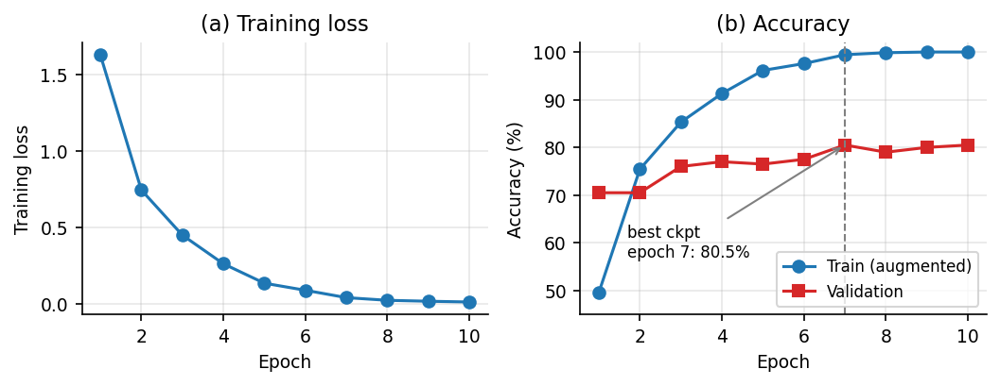
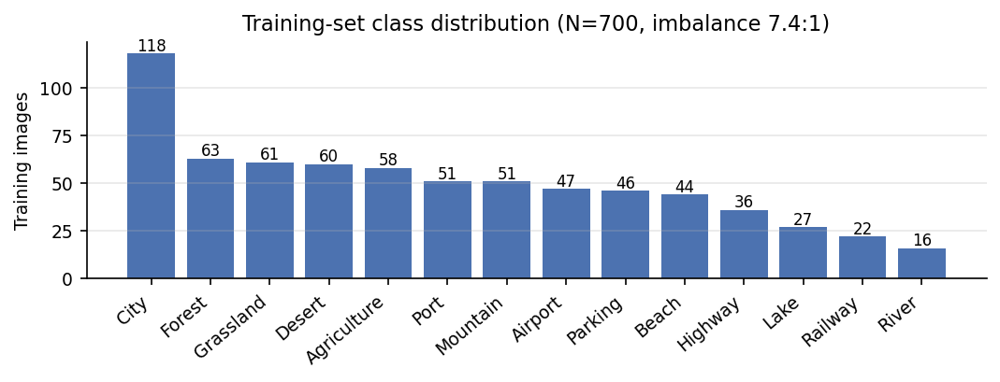

<div align="center">

# 🛰️ SatScene: Land-Use Scene Classification with ConvNeXt-Tiny and a Rule-Based Decision-Support Agent


*Geospatial Data Science course · Home Assignment 1 (Software Project) · 2026*

</div>

---

## Abstract

We fine-tune an ImageNet-22k pre-trained **ConvNeXt-Tiny** (27.83 M parameters) on a small, 14-class overhead-imagery dataset (700 / 200 / 100 images for train / validation / test). The best checkpoint reaches **80.5 % validation accuracy** (95 % Wilson interval 74.5–85.4 %, *n* = 200) while training accuracy saturates at 100 %, indicating over-fitting on the 700 training images. A rule-based decision-support layer maps each predicted class to a suggested follow-up geospatial analysis. The optional LaTeX write-up is in the local `paper/` folder; that folder is ignored by Git and is not included in repository clones.

> **Read this first — status of the numbers.** The 80.5 % figure comes from the saved output of the original Colab notebook ([`notebooks/GIS_project_original.ipynb`](notebooks/GIS_project_original.ipynb)). The **test split has not been evaluated yet**, and the packaged code in `src/` has not been re-run end-to-end on the dataset. See [Known limitations](#known-limitations) and [Reproducing the results](#reproducing-the-results).

## Results at a glance

| | Value |
| --- | --- |
| Backbone | `convnext_tiny.fb_in22k_ft_in1k` (timm), 27.83 M params |
| Data | 14 classes · 700 train / 200 val / 100 test |
| Best checkpoint | epoch 7 of 10 |
| **Validation accuracy** | **80.5 %** (161/200; 95 % CI 74.5–85.4 %) |
| Final train accuracy | 100 % (augmented, train mode) → 19.5 pp train–val gap |
| **Test accuracy** | *not yet evaluated* → run `python -m satscene.evaluate --split test` |

<p align="center">
  
</p>

<p align="center">
  
</p>

Caveats that matter when reading these numbers: validation data was used to select the checkpoint (so 80.5 % is optimistic), the run was single and unseeded (no variance estimate), and per-class metrics were not logged.

## Method in brief

| Component | Choice |
| --- | --- |
| Input | RGB, resized to 224 × 224, ImageNet mean/std |
| Augmentation | horizontal flip, vertical flip, random 90° rotation (p = 0.5 each) |
| Loss / optimiser | cross-entropy · AdamW (lr 3e-4, wd 1e-4) |
| Schedule | 10 epochs, batch 32, cosine annealing (`T_max = 10`) |
| Precision | fp16 mixed precision with loss scaling (CUDA only) |
| Model selection | save weights on strictly better validation accuracy |

**Agent layer** (`src/satscene/agent.py`): (1) *perceive* — softmax over the 14 classes; (2) *reason* — look up the predicted class in a static knowledge table ([`knowledge.py`](src/satscene/knowledge.py)); (3) *report* — markdown with top-3 classes, a suggested follow-up analysis, and a low-confidence flag (< 0.5). It is a rule-based decision-support layer: the suggestions are for a human analyst and nothing is executed.

## Dataset

[`umeradnaan/remote-sensing-satellite-images`](https://www.kaggle.com/datasets/umeradnaan/remote-sensing-satellite-images) on Kaggle (CC0-1.0), a Roboflow **YOLOv8 detection** export with 14 classes: *Agriculture, Airport, Beach, City, Desert, Forest, Grassland, Highway, Lake, Mountain, Parking, Port, Railway, River*.

Scene labels are **derived** from the detection labels: each image gets its most frequent class id (ties → first appearing); images with empty label files are skipped and reported. The images are plain JPEGs with **no CRS, geotransform or band metadata**, so this is image classification rather than georeferenced raster analysis.

## Installation

```bash
# From the project directory:
python -m venv .venv && source .venv/bin/activate
pip install -r requirements.txt
pip install -e .            # makes `python -m satscene.*` available
```

A CUDA GPU is recommended; the code also runs on CPU (slowly, without mixed precision).

## Reproducing the results

```bash
# 1. data (needs Kaggle credentials: ~/.kaggle/kaggle.json or KAGGLE_USERNAME/KAGGLE_KEY)
bash scripts/download_data.sh

# 2. train (hyper-parameters in configs/default.yaml)
python -m satscene.train --config configs/default.yaml
#    -> runs/convnext_tiny/best_model.pth and history.json

# 3. evaluate ONCE on the held-out test split
python -m satscene.evaluate --config configs/default.yaml --split test
#    -> runs/convnext_tiny/metrics_test.json and confusion_test.png

# 4. interactive demo
python -m satscene.app --config configs/default.yaml        # add --share for a public link

# 5. regenerate figures from the logged run, and run the tests
python scripts/make_figures.py
PYTHONPATH=src pytest -q
```

Expect results to differ from the logged run: the notebook run was unseeded, and its saved label-derivation code conflicts with its output. The packaged training code is seeded and derives labels from the YOLO annotations. After obtaining a new run, update `results/training_log.json` if you want the figures to reflect it, then run `python scripts/make_figures.py`.

## Repository structure

```
satellite-scene-agent/
├── README.md
├── .gitignore
├── CITATION.cff
├── LICENSE
├── pyproject.toml
├── requirements.txt
├── src/satscene/
│   ├── labels.py            # YOLO annotation parsing and class utilities
│   ├── data.py              # image transforms and data loaders
│   ├── model.py             # ConvNeXt-Tiny and checkpoint utilities
│   ├── train.py             # training loop
│   ├── evaluate.py          # split metrics and confusion matrix
│   ├── agent.py             # prediction report wrapper
│   ├── knowledge.py         # class-specific follow-up suggestions
│   ├── metrics.py           # Wilson confidence interval
│   └── app.py               # Gradio demo
├── configs/default.yaml
├── scripts/
│   ├── download_data.sh
│   └── make_figures.py
├── results/
│   ├── training_log.json
│   └── figures/
├── notebooks/GIS_project_original.ipynb  # original code with explanatory Markdown added
├── tests/
│   ├── test_labels.py
│   └── test_knowledge_and_log.py
└── paper/                   # local only; ignored by Git
```

## What changed relative to the original notebook

| Notebook | This repo | Why |
| --- | --- | --- |
| Data cell assigns `class_names[0]` to **every** image ("dummy labels"), yet its saved output says *"Parsed true classes"* with a 14-class distribution | Real label parsing in `labels.py`, with unit tests | The saved code and saved output disagree; the logged results must have come from a different version of that cell |
| Agent knowledge table keyed on `"agricultural"`, `"terminal"`, `"car parking"`, `"road"`, `"train"`, `"domestic"` … | Keys equal the 14 dataset class names; a test asserts full coverage | 6 of 14 classes (Agriculture, Airport, Grassland, Highway, Parking, Railway) would have returned *"Unknown Land Use"*; Grassland had no entry |
| `GradScaler('cuda')` / `device_type='cuda'` hard-coded | Device-aware AMP | Crashes on CPU otherwise |
| No random seed | `seed` in config | Reproducibility |
| Test split loaded but never used | `evaluate.py` | Needed for an honest estimate |
| Single `analyze()` returning a string | Also `analyze_structured()` with top-3 and a low-confidence flag | Programmatic use |
| Unused imports (`seaborn`, `confusion_matrix`, …) | Used in `evaluate.py` | — |

The notebook code cells are preserved; explanatory Markdown has been added before each code cell. The notes call out the dummy-label, CUDA-only AMP, and class-name lookup limitations in the original code.

## Known limitations

- **No test result yet**, and `src/` has not been re-run against the real dataset; the reported numbers are transcribed from the notebook's saved output.
- **Validation-selected checkpoint**: 80.5 % is optimistically biased; with 200 images, differences of a few points are within noise.
- **Single unseeded run**, so no variance across seeds. The confidence interval only reflects validation-set sampling noise.
- **Over-fitting**: 100 % train vs ~80 % validation accuracy; the validation curve is flat after epoch 4.
- **Class imbalance** (City 118 vs River 16, 7.4 : 1) and no per-class metrics logged. Weighted loss is available via `class_weighted_loss: true` but untested.
- **Derived labels** from detection boxes may be noisy for mixed scenes; no check for near-duplicates across splits; sensor, resolution and dates unknown.
- **Not georeferenced**: no CRS or spectral bands, so no spatial cross-validation and no real NDVI. The agent's follow-ups are suggestions only.

## Roadmap

- [ ] Evaluate on the test split; add confusion matrix and per-class F1 to the paper
- [ ] Multi-seed runs (mean ± std)
- [ ] Ablations: class-weighted loss, stronger augmentation, label smoothing, TTA
- [ ] Near-duplicate audit across splits
- [ ] Georeferenced benchmark (e.g. EuroSAT) to connect the agent to real NDVI/DEM data

## Citation

Citation metadata is provided in [`CITATION.cff`](CITATION.cff). Replace its author and repository placeholders before publishing or archiving the project.

## References

Key works are cited in the optional paper source under the local `paper/` folder. That folder is ignored by Git, so its bibliography is not present in repository clones.

## License

Code: [MIT](LICENSE). Dataset: CC0-1.0 (see its Kaggle page). Pre-trained weights are subject to their own licences via `timm`.
