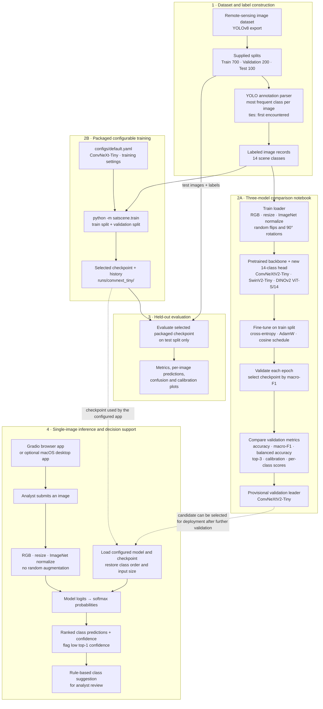
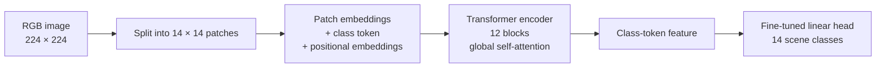
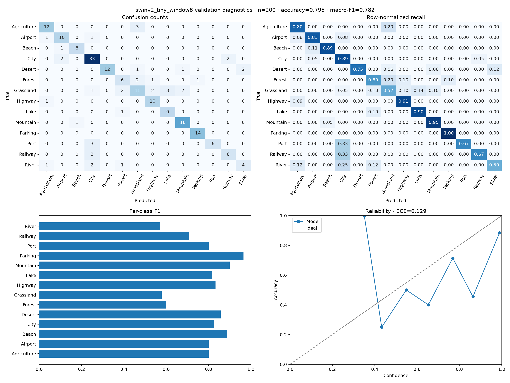
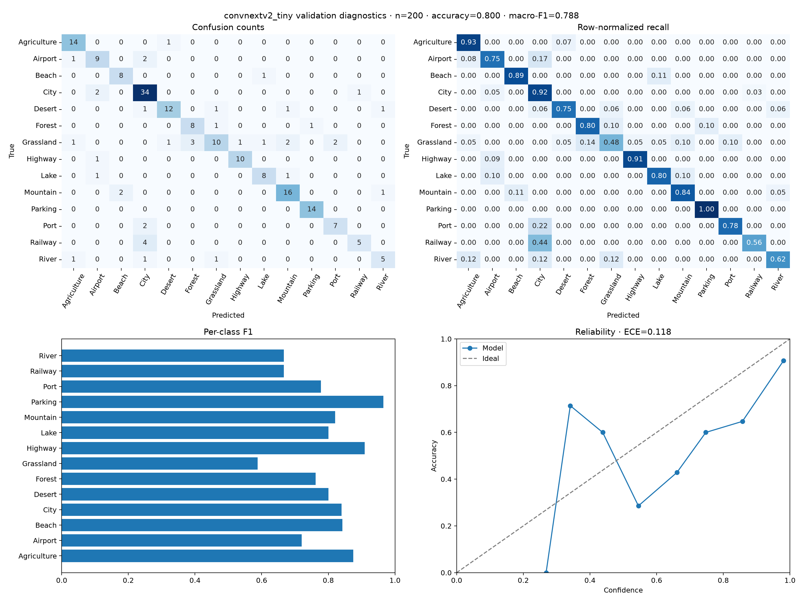
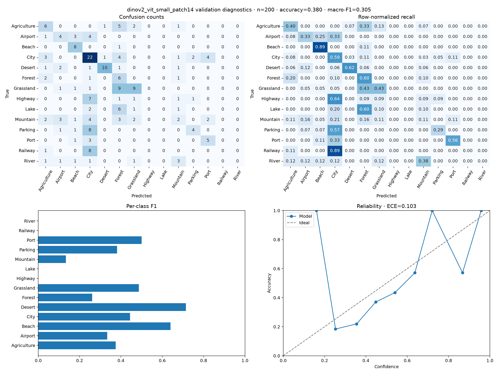
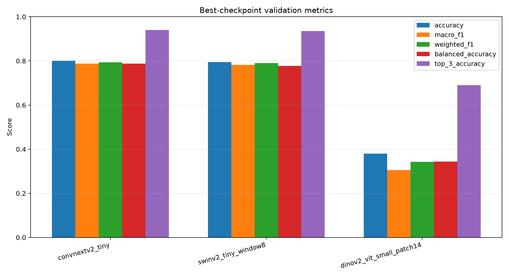
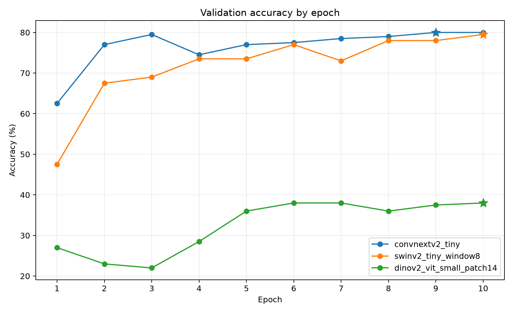
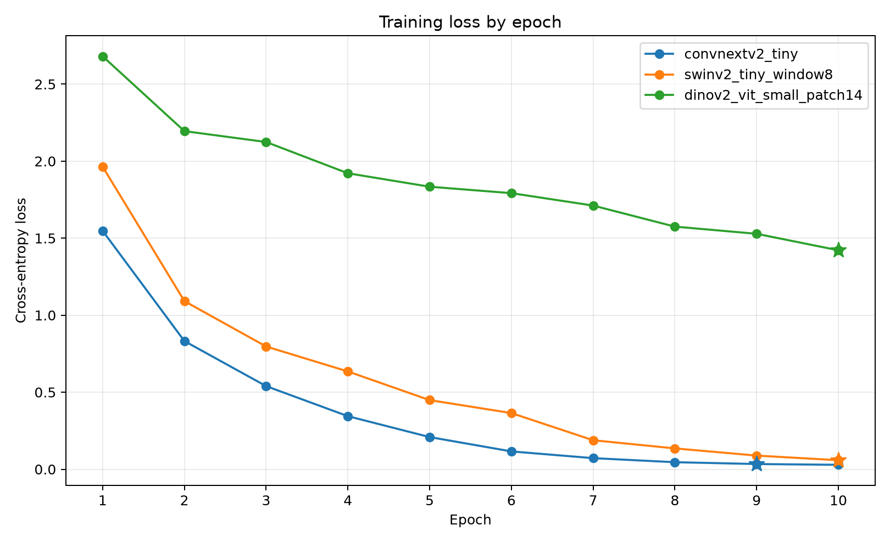

<div align="center">

# 🛰️ SatScene: Satellite Imagery Classification Using Deep Learning — A Comparative Study of Pretrained Vision Models

*Geospatial Data Science · Home Assignment 1 · Software Project · 2026*

</div>

---

## Abstract

SatScene is a remote-sensing image-classification project and reproducible software
workflow for assigning one of 14 land-use scene labels to satellite or aerial images.
The repository includes YOLO-annotation parsing, transfer-learning training and
evaluation, a browser interface, and an optional native macOS interface. A comparison
of three pretrained vision backbones on a 200-image validation split found that
ConvNeXtV2-Tiny ranked first in validation accuracy (80.0%), macro-F1 (0.788), and
top-3 accuracy (94.0%), narrowly ahead of SwinV2-Tiny. DINOv2 ViT-S/14 performed
substantially worse under the same fine-tuning protocol. These are single-run
validation results, not estimates from the held-out test set. The results support a
software and experimental comparison, not a claim of operationally reliable
classification.

**Keywords:** remote sensing; satellite imagery; scene classification; transfer
learning; ConvNeXt; Swin Transformer; DINOv2; decision support

## Contents

- [1. Project scope](#1-project-scope)
- [2. Dataset and label construction](#2-dataset-and-label-construction)
- [3. Methods](#3-methods)
- [4. Experimental protocol](#4-experimental-protocol)
- [5. Results](#5-results)
- [6. Discussion](#6-discussion)
- [7. Limitations](#7-limitations)
- [8. Reproducibility and use](#8-reproducibility-and-use)
- [9. Software and archive contents](#9-software-and-archive-contents)
- [References and licenses](#references-and-licenses)

## 1. Project scope

SatScene studies image-level land-use scene classification using a small remote-sensing
dataset. It packages data handling, model training, validation, evaluation, and
single-image prediction in a Python project. The local interfaces show ranked class
predictions and rule-based follow-up suggestions for human review.

The supplied images are ordinary JPEGs without coordinates, a coordinate reference
system, geotransforms, or multispectral bands. SatScene therefore analyzes image
appearance only: it does not perform georeferenced raster analysis, calculate NDVI,
read elevation data, or execute the suggested follow-up analyses.

### 1.1 End-to-end project pipeline

The diagram follows data from the YOLO export through training, evaluation, and
single-image decision support. SatScene has two related training routes: the notebook
compares three backbones, while the packaged command-line training pipeline uses the
configurable model in `configs/default.yaml`. The packaged pipeline's held-out
evaluation is separate from the notebook's three-model validation comparison.



The notebook comparison chooses a model using validation macro-F1; it does not by
itself establish generalization. Keep the test split out of model selection and use it
only for final evaluation. The class suggestion is static decision support, not an
automated GIS analysis.

## 2. Dataset and label construction

The source is the [Remote Sensing Satellite Images dataset on Kaggle](https://www.kaggle.com/datasets/umeradnaan/remote-sensing-satellite-images),
distributed in a [Roboflow YOLOv8 export](https://universe.roboflow.com/image-captioning-for-remote-sensingdata-0zids/remote-sensing-data/dataset/2).
The export contains 1,000 images in supplied train, validation, and test splits
(700/200/100) and 14 classes:

> Agriculture · Airport · Beach · City · Desert · Forest · Grassland · Highway · Lake ·
> Mountain · Parking · Port · Railway · River

The export annotations are object detections rather than scene labels. For each image,
the implementation chooses the most frequent class ID in its YOLO annotation file;
ties go to the class appearing first. Images with missing or empty annotation files are
skipped. This provides a single-label classification target, but the dominant detected
object is only a proxy for the overall scene.

The training split is imbalanced: the recorded distribution ranges from 118 City images
to 16 River images (7.4:1). The dataset is not included in Git. The downloaded Roboflow
export identifies its license as CC BY 4.0; verify attribution and redistribution terms
at the [source](https://universe.roboflow.com/image-captioning-for-remote-sensingdata-0zids/remote-sensing-data/dataset/2)
before reuse. Dataset provenance is also recorded in
[`resources/dataset_source.txt`](resources/dataset_source.txt).

## 3. Methods

### 3.1 Image preparation

Images are read as RGB, resized to the model's configured square input size, and
normalized using ImageNet channel statistics. Training augmentation applies horizontal
flip, vertical flip, and random 90-degree rotation, each with probability 0.5. Validation
and evaluation use resize and normalization without random augmentation.

### 3.2 Model comparison

The comparison notebook uses the same supervised image-classification task and
fine-tuning recipe for three pretrained `timm` backbones. A fresh classification head
maps each backbone's image features to the project's 14 scene classes; the optimizer
updates the head and the pretrained backbone.

| Model | Architecture and what it contributes here | `timm` model identifier | Input |
| --- | --- | --- | ---: |
| **ConvNeXtV2-Tiny** | Hierarchical convolutional stages combine local texture and progressively larger spatial features. ConvNeXtV2 adds Global Response Normalization (GRN) to its ConvNeXt blocks (Woo et al., 2023). This is the best-performing candidate in this validation run. | `convnextv2_tiny.fcmae_ft_in1k` | 224 × 224 |
| **SwinV2-Tiny** | A hierarchical vision transformer computes attention within local windows, shifting windows between blocks so information can cross window boundaries. Its patch-merging stages capture increasingly broad context (Liu et al., 2022); this run uses the model's 256 × 256 input configuration. | `swinv2_tiny_window8_256.ms_in1k` | 256 × 256 |
| **DINOv2 ViT-S/14** | A Vision Transformer divides the image into 14 × 14 patches and uses global self-attention across patch tokens. Its backbone starts from DINOv2 self-supervised visual features (`lvd142m`; Oquab et al., 2023); the project then fine-tunes it for the 14 labeled scene classes. | `vit_small_patch14_dinov2.lvd142m` | 224 × 224 |

#### Architecture diagrams

These simplified diagrams show each pretrained backbone and the 14-class head used in
SatScene. They are original schematics based on the cited architecture papers, not
reproductions of the papers' figures. Follow each model name to its research paper.

**ConvNeXtV2-Tiny** — hierarchical convolutional stages with GRN in the ConvNeXtV2
blocks ([Woo et al., 2023](https://openaccess.thecvf.com/content/CVPR2023/html/Woo_ConvNeXt_V2_Co-Designing_and_Scaling_ConvNets_With_Masked_Autoencoders_CVPR_2023_paper.html)).

```mermaid
flowchart LR
    A["RGB image<br/>224 × 224"] --> B["Stem<br/>4 × 4 convolution"]
    B --> C["Stage 1<br/>ConvNeXtV2 blocks × 3<br/>GRN"]
    C --> D["Downsample"]
    D --> E["Stage 2<br/>ConvNeXtV2 blocks × 3<br/>GRN"]
    E --> F["Downsample"]
    F --> G["Stage 3<br/>ConvNeXtV2 blocks × 9<br/>GRN"]
    G --> H["Downsample"]
    H --> I["Stage 4<br/>ConvNeXtV2 blocks × 3<br/>GRN"]
    I --> J["Global average pool"]
    J --> K["Fine-tuned linear head<br/>14 scene classes"]
```



**Swin Transformer V2-Tiny** — hierarchical shifted-window attention, with patch
merging between stages ([Liu et al., 2022](https://openaccess.thecvf.com/content/CVPR2022/html/Liu_Swin_Transformer_V2_Scaling_Up_Capacity_and_Resolution_CVPR_2022_paper.html)).

```mermaid
flowchart LR
    A["RGB image<br/>256 × 256"] --> B["Patch embedding"]
    B --> C["Stage 1<br/>Window + shifted-window<br/>attention blocks × 2"]
    C --> D["Patch merge"]
    D --> E["Stage 2<br/>Window + shifted-window<br/>attention blocks × 2"]
    E --> F["Patch merge"]
    F --> G["Stage 3<br/>Window + shifted-window<br/>attention blocks × 6"]
    G --> H["Patch merge"]
    H --> I["Stage 4<br/>Window + shifted-window<br/>attention blocks × 2"]
    I --> J["Norm + global average pool"]
    J --> K["Fine-tuned linear head<br/>14 scene classes"]
```



**DINOv2 ViT-S/14** — global self-attention over patch tokens, initialized from
self-supervised DINOv2 features and fine-tuned for this project
([Oquab et al., 2023](https://arxiv.org/abs/2304.07193)).



#### Comparison training pipeline

```text
YOLO export + image files
  → one image label: most frequent annotated class (ties: first class encountered)
  → train/validation loaders; RGB resize + ImageNet normalization
  → train-only random horizontal/vertical flips and 90° rotations (p = 0.5 each)
  → pretrained backbone + new 14-class head
  → cross-entropy fine-tuning (AdamW, lr 3e-4, weight decay 1e-4)
  → validation after each epoch; cosine learning-rate schedule
  → save the checkpoint with the highest validation macro-F1
  → compare accuracy, macro-F1, balanced accuracy, top-3 accuracy,
    calibration, and per-class errors
```

All three runs use seed 42, batch size 16, and 10 epochs. The input is 224 × 224 for
ConvNeXtV2 and DINOv2, and 256 × 256 for SwinV2. The augmentation and
ImageNet-normalization pipeline is shared; only resize dimensions vary. Training uses
the 700-image train split and model selection uses the 200-image validation split. The
100-image test split is not used to select these comparison checkpoints. See
[`src/satscene/data.py`](src/satscene/data.py) for transforms and loaders and
[`notebooks/GIS_project_original.ipynb`](notebooks/GIS_project_original.ipynb) for the
comparison training loop.

Architecturally, ConvNeXtV2 builds on the modernized ConvNet design of ConvNeXt (Liu et
al., 2022; Woo et al., 2023), using convolutional filters for local patterns and
hierarchical feature maps; SwinV2 uses windowed attention to model spatial relationships
with less cost than global attention at every layer (Liu et al., 2022); DINOv2 ViT-S/14
uses global attention over patch tokens and relies on a large self-supervised pretrained
representation (Oquab et al., 2023). These differences are plausible inductive biases
for aerial scenes, not guarantees of performance: the results below measure these exact
pretrained checkpoints and this particular small-data fine-tuning setup.

### 3.3 Prediction and decision support

For an input image, the classifier returns softmax scores for the 14 classes. The
rule-based reporting layer presents the top predictions, flags low top-1 confidence,
and looks up a static suggestion associated with the predicted class. Suggestions are
for an analyst; the application does not carry them out.

## 4. Experimental protocol

The reported architecture comparison uses the validation split (`n = 200`) for model
selection and comparison. Its results are from one run and have no across-seed
uncertainty estimate. Accuracy intervals below are 95% Wilson score intervals; they
describe binomial sampling uncertainty for the validation sample, not variation from
retraining. The intervals overlap, so the small lead between the top two models should
not be treated as evidence of a statistically reliable difference.

The test set is intended for final evaluation after the method is selected. The
separately archived test output is from the ConvNeXt-Tiny command-line pipeline, not
from the three comparison checkpoints. It is reported independently below and was not
used to select the comparison models.

## 5. Results

### 5.1 Validation comparison

| Model | Accuracy (95% Wilson CI) | Macro-F1 | Balanced accuracy | Weighted F1 | Top-3 accuracy | ECE |
| --- | ---: | ---: | ---: | ---: | ---: | ---: |
| **ConvNeXtV2-Tiny** | **80.0% (73.9–85.0%)** | **0.788** | **0.788** | **0.793** | **94.0%** | 0.118 |
| SwinV2-Tiny | 79.5% (73.4–84.5%) | 0.782 | 0.777 | 0.790 | 93.5% | 0.129 |
| DINOv2 ViT-S/14 | 38.0% (31.6–44.9%) | 0.305 | 0.344 | 0.342 | 69.0% | **0.103** |

ECE is expected calibration error (lower is better, but it does not measure
classification quality by itself). ConvNeXtV2 is the best choice **among these three
recorded validation runs**: it has the highest macro-F1, accuracy, balanced accuracy,
weighted F1, and top-3 accuracy. Its margin over SwinV2 is small (one more correct
validation image and 0.006 higher macro-F1), and the accuracy intervals overlap. DINOv2
has the lowest ECE, but its much lower classification scores make it the weakest
predictor overall here.

The complete aggregate metrics are in
[`runs/model_comparison_metrics.csv`](runs/model_comparison_metrics.csv). Each model
folder contains its exact run configuration, per-image predictions, per-class report,
confusion matrices, and calibration diagnostics.

### 5.2 Model-level diagnostics

<details>
<summary><strong>SwinV2-Tiny</strong> — close second on validation macro-F1</summary>



[Full metrics](runs/swinv2_tiny_window8/metrics_valid.json) ·
[Per-image predictions](runs/swinv2_tiny_window8/predictions_valid.csv) ·
[Run configuration](runs/swinv2_tiny_window8/config.json)

</details>

<details>
<summary><strong>ConvNeXtV2-Tiny</strong> — best overall validation scores</summary>



[Full metrics](runs/convnextv2_tiny/metrics_valid.json) ·
[Per-image predictions](runs/convnextv2_tiny/predictions_valid.csv) ·
[Run configuration](runs/convnextv2_tiny/config.json)

</details>

<details>
<summary><strong>DINOv2 ViT-S/14</strong></summary>



[Full metrics](runs/dinov2_vit_small_patch14/metrics_valid.json) ·
[Per-image predictions](runs/dinov2_vit_small_patch14/predictions_valid.csv) ·
[Run configuration](runs/dinov2_vit_small_patch14/config.json)

</details>

### 5.3 Per-class performance of SwinV2-Tiny

The per-class F1 results show why the macro-average and class support matter. SwinV2
performed strongly on several classes, while Grassland, Forest, and River remained
difficult.

| Class | Support | Precision | Recall | F1 |
| --- | ---: | ---: | ---: | ---: |
| Agriculture | 15 | 0.800 | 0.800 | 0.800 |
| Airport | 12 | 0.769 | 0.833 | 0.800 |
| Beach | 9 | 0.889 | 0.889 | 0.889 |
| City | 37 | 0.767 | 0.892 | 0.825 |
| Desert | 16 | 1.000 | 0.750 | 0.857 |
| Forest | 10 | 0.600 | 0.600 | 0.600 |
| Grassland | 21 | 0.647 | 0.524 | 0.579 |
| Highway | 11 | 0.769 | 0.909 | 0.833 |
| Lake | 10 | 0.750 | 0.900 | 0.818 |
| Mountain | 19 | 0.857 | 0.947 | 0.900 |
| Parking | 14 | 0.933 | 1.000 | 0.966 |
| Port | 9 | 1.000 | 0.667 | 0.800 |
| Railway | 9 | 0.750 | 0.667 | 0.706 |
| River | 8 | 0.667 | 0.500 | 0.571 |

Values are transcribed from
[`runs/swinv2_tiny_window8/metrics_valid.json`](runs/swinv2_tiny_window8/metrics_valid.json);
per-class scores are sensitive to the small number of examples in each class.

### 5.4 Comparison figures







### 5.5 Held-out test evaluation

The packaged ConvNeXt-Tiny command-line pipeline can evaluate the selected checkpoint
on the held-out test split and writes metrics and per-image predictions to its output
directory. This evaluation is separate from the three-model validation comparison;
the comparison checkpoints have not been ranked using test results. Reserve the test
split for final assessment after model selection.

## 6. Discussion

Within this single validation comparison, ConvNeXtV2-Tiny ranked first on macro-F1,
top-1 accuracy, balanced accuracy, weighted F1, and top-3 accuracy; SwinV2-Tiny was a
close second. The practical choice for this project is therefore ConvNeXtV2-Tiny if
choosing only from these validation runs. This is a provisional model-selection result,
not a claim that ConvNeXtV2 is inherently superior: the runs share one seed, the
validation sample is small, and no repeated-seed uncertainty is available. DINOv2
ViT-S/14 performed substantially worse under the recorded fine-tuning setup, despite
its large self-supervised pretraining.

The per-class report shows high validation F1 for Parking, Port, Beach, and Mountain,
but lower F1 for Grassland, Forest, and River. Small class supports make these estimates
uncertain. Validation metrics alone do not establish robust performance. Further
evaluation across repeated runs and a carefully audited held-out test set is needed
before any deployment claim.

## 7. Limitations

- **Single comparison run:** there are no repeated seeds or variance estimates.
- **Small, imbalanced dataset:** 1,000 images are few for a 14-class task, and class
  supports range from 8 to 37 in validation.
- **Proxy labels:** assigning the most frequent detection class as the scene label can
  misrepresent mixed or multi-object scenes.
- **No geospatial metadata:** spatial splits, geographic generalization, and actual GIS
  measurements cannot be evaluated with these JPEGs.
- **Dataset and model provenance:** dataset redistribution and pretrained-weight terms
  are external to this code license and must be checked independently.
- **Validation-selected results:** the reported comparison values are model-selection
  metrics, not final test estimates.

The earlier notebook also contains historical output that is not used as a verified
result because its saved label-generation code and displayed class-distribution output
disagree. The current comparison values above are taken from the three archived run
folders.

## 8. Reproducibility and use

### 8.1 Environment

Requires Python 3.10 or later; Python 3.11 is recommended. From the repository root:

```bash
python3 -m venv .venv
source .venv/bin/activate
python -m pip install --upgrade pip
python -m pip install -r requirements.txt
python -m pip install -e .
```

### 8.2 Dataset setup

The dataset is not tracked in the repository. Configure Kaggle CLI credentials, then
download and extract it:

```bash
bash scripts/download_data.sh
```

The configured directory is `data/Remote Sensing Data.v2i.yolov8`, containing
`data.yaml` and the `train`, `valid`, and `test` split directories. Change `data.root`
in [`configs/default.yaml`](configs/default.yaml) if your extracted path differs.

### 8.3 Train and evaluate the packaged ConvNeXt-Tiny pipeline

```bash
python -m satscene.train --config configs/default.yaml
python -m satscene.evaluate --config configs/default.yaml --split test
```

Training writes the selected checkpoint and history to `runs/convnext_tiny/`. Evaluation
writes aggregate metrics, predictions, and diagnostic plots in the configured output
directory. Reserve the test split for final evaluation after model selection.

### 8.4 Reproduce the three-model comparison

Open [`notebooks/GIS_project_original.ipynb`](notebooks/GIS_project_original.ipynb)
in Jupyter or Google Colab and run the comparison workflow. It fine-tunes the three
models described in [Section 3](#3-methods) and writes per-model reports and plots under
`runs/`. The large `.pth` checkpoint files are deliberately excluded from Git; rerun
the notebook to recreate them.

### 8.5 Run the applications and tests

```bash
# Local browser interface; open http://127.0.0.1:7860
python -m satscene.app --config configs/default.yaml

# Optional native macOS interface
python -m satscene.desktop --config configs/default.yaml

# Tests
python -m pip install -e '.[dev]'
python -m pytest -q
```

On Apple Silicon, PyTorch uses MPS when available and otherwise falls back to CPU.
CUDA is used when available. Pretrained weights are downloaded on the first run, so
initial training requires internet access. Checkpoints are ignored by Git because of
their size; supply a locally available checkpoint using `--checkpoint` where needed.

## 9. Software and archive contents

| Path | Contents |
| --- | --- |
| `src/satscene/labels.py` | YOLO label parsing and class utilities |
| `src/satscene/data.py` | Image transforms and data loaders |
| `src/satscene/model.py` | Model construction and checkpoint utilities |
| `src/satscene/train.py` | Configurable training pipeline |
| `src/satscene/evaluate.py` | Evaluation metrics, predictions, and diagnostic plots |
| `src/satscene/agent.py`, `knowledge.py` | Prediction report and static class suggestions |
| `src/satscene/app.py`, `desktop.py` | Browser and optional macOS interfaces |
| `configs/default.yaml` | Packaged ConvNeXt-Tiny configuration |
| `notebooks/` | Three-model comparison workflow |
| `runs/` | Comparison metrics, predictions, configurations, and plots |
| `iodata/` | Sample input and archived test-output example |
| `docs/` | macOS setup and experiment protocol |
| `tests/` | Automated tests |
| `resources/` | Dataset provenance and references |

The comparison summaries and diagnostics are committed; trained checkpoint files are
not. The optional LaTeX/PDF submission materials in `paper/` are local-only and are not
part of the tracked software archive.

## References and licenses

- Liu, Z. et al. (2022). [A ConvNet for the 2020s](https://openaccess.thecvf.com/content/CVPR2022/html/Liu_A_ConvNet_for_the_2020s_CVPR_2022_paper.html). *CVPR*.
- Woo, S. et al. (2023). [ConvNeXt V2: Co-designing and Scaling ConvNets with Masked Autoencoders](https://openaccess.thecvf.com/content/CVPR2023/html/Woo_ConvNeXt_V2_Co-Designing_and_Scaling_ConvNets_With_Masked_Autoencoders_CVPR_2023_paper.html). *CVPR*.
- Liu, Z. et al. (2022). [Swin Transformer V2: Scaling Up Capacity and Resolution](https://openaccess.thecvf.com/content/CVPR2022/html/Liu_Swin_Transformer_V2_Scaling_Up_Capacity_and_Resolution_CVPR_2022_paper.html). *CVPR*.
- Oquab, M. et al. (2023). [DINOv2: Learning Robust Visual Features without Supervision](https://arxiv.org/abs/2304.07193). arXiv:2304.07193.
- Wightman et al. [PyTorch Image Models (`timm`)](https://github.com/huggingface/pytorch-image-models).
- Dataset provenance and export details: [`resources/README.md`](resources/README.md).

Citation metadata is provided in [`CITATION.cff`](CITATION.cff). The software is
licensed under the [MIT License](LICENSE). Dataset and pretrained-model licenses are
separate; consult their original sources before redistribution.
