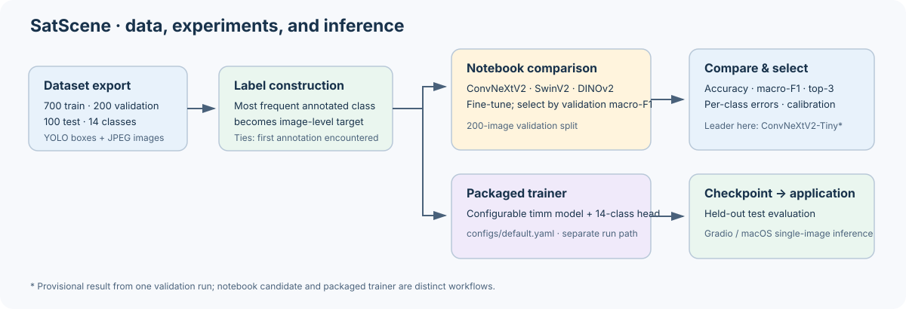
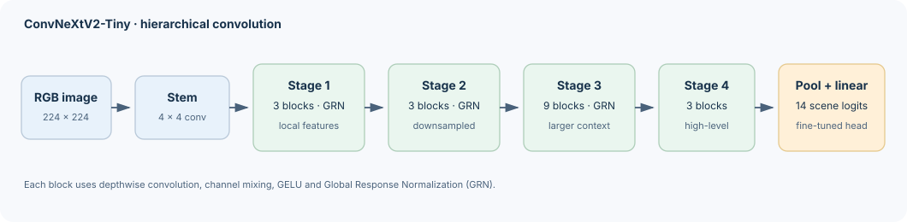
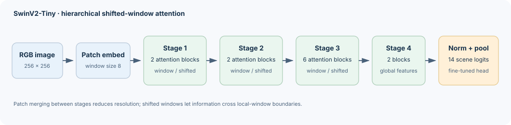
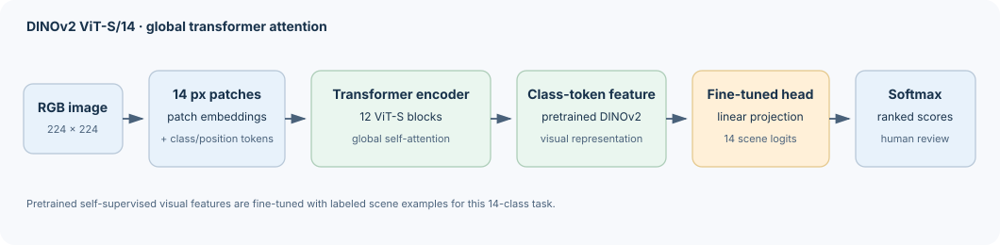

# SatScene: Satellite Scene Classification with Pretrained Vision Models

<div align="center">

**S M Gazzali Arafat Nishan**<br>
*Faculty of Computer Science, HSE University, Moscow, Russia*<br>
*Geospatial Data Science · Software Project · Version 0.1.0 · 2026*

</div>

---

## Abstract

SatScene is a remote-sensing image-classification project and software workflow for
assigning one of 14 land-use labels to satellite or aerial RGB images. It includes YOLO
annotation parsing, transfer-learning training and evaluation, and browser and macOS
interfaces for ranked predictions and analyst review. Archived validation artifacts
compare ConvNeXtV2-Tiny, SwinV2-Tiny, and DINOv2 ViT-S/14 on 200 images. ConvNeXtV2-Tiny
has the highest recorded accuracy (80.0%) and macro-F1 (0.788), one image ahead of
SwinV2-Tiny; DINOv2 ViT-S/14 records 38.0% accuracy. These validation metrics come from
one run per model. The notebook uses the repository's YOLO label parser and its saved
output reports the corresponding 14-class train and validation distributions.

**Keywords —** remote sensing; satellite imagery; scene classification; transfer
learning; ConvNeXt; Swin Transformer; DINOv2; decision support

## Contents

- [1. Project scope](#1-project-scope)
- [2. Dataset and label construction](#2-dataset-and-label-construction)
- [3. Methods](#3-methods)
- [4. Experimental protocol](#4-experimental-protocol)
- [5. Results](#5-results)
- [6. Discussion](#6-discussion)
- [7. Limitations](#7-limitations)
- [8. Reproducibility and use](#8-reproducibility-and-use)
- [9. Software and archive contents](#9-software-and-archive-contents)
- [References and licenses](#references-and-licenses)

## 1. Project scope

SatScene studies image-level land-use scene classification using a small remote-sensing
dataset. It packages data handling, model training, validation, evaluation, and
single-image prediction in a Python project. The local interfaces show ranked class
predictions and rule-based follow-up suggestions for human review.

The supplied images are ordinary JPEGs without coordinates, a coordinate reference
system, geotransforms, or multispectral bands. SatScene therefore analyzes image
appearance only: it does not perform georeferenced raster analysis, calculate NDVI,
read elevation data, or execute the suggested follow-up analyses.

### 1.1 End-to-end project pipeline

The figure follows data from the YOLO export through training, evaluation, and
single-image decision support. SatScene has two related but distinct training routes:
the notebook compares three backbones, while the packaged command-line pipeline uses
the configurable model in `configs/default.yaml`. The archived held-out test example
comes from the packaged pipeline and is not the test evaluation of the comparison
checkpoints.



The comparison notebook derives labels with the maintained YOLO parser and reports the
resulting class distributions. Each model has one saved run, so the results do not measure
variation across seeds. Keep the test split out of model selection and use it only for
final evaluation. The class suggestion is static decision support, not an automated GIS
analysis.

## 2. Dataset and label construction

The source is the [Remote Sensing Satellite Images dataset on Kaggle](https://www.kaggle.com/datasets/umeradnaan/remote-sensing-satellite-images),
distributed in a [Roboflow YOLOv8 export](https://universe.roboflow.com/image-captioning-for-remote-sensingdata-0zids/remote-sensing-data/dataset/2).
The export contains 1,000 images in supplied train, validation, and test splits
(700/200/100) and 14 classes:

> Agriculture · Airport · Beach · City · Desert · Forest · Grassland · Highway · Lake ·
> Mountain · Parking · Port · Railway · River

The export annotations are object detections rather than scene labels [20]. For each image,
the implementation chooses the most frequent class ID in its YOLO annotation file;
ties go to the class appearing first. Images with missing or empty annotation files are
skipped. This provides a single-label classification target, but the dominant detected
object is only a proxy for the overall scene.

The training split is imbalanced: the recorded distribution ranges from 118 City images
to 17 River images (6.9:1). The dataset is not included in Git. The downloaded Roboflow
export identifies its license as CC BY 4.0; verify attribution and redistribution terms
at the [source](https://universe.roboflow.com/image-captioning-for-remote-sensingdata-0zids/remote-sensing-data/dataset/2)
before reuse. Dataset provenance is also recorded in
[`resources/dataset_source.txt`](resources/dataset_source.txt).

## 3. Methods

### 3.1 Image preparation

Images are read as RGB, resized to the model's configured square input size, and
normalized using ImageNet channel statistics. Training augmentation applies horizontal
flip, vertical flip, and random 90-degree rotation, each with probability 0.5. Validation
and evaluation use resize and normalization without random augmentation.

### 3.2 Model comparison

The comparison notebook uses the same supervised image-classification task and
fine-tuning recipe for three pretrained `timm` backbones. A fresh classification head
maps each backbone's image features to the project's 14 scene classes; the optimizer
updates the head and the pretrained backbone.

| Model | Architecture and what it contributes here | `timm` model identifier | Input |
| --- | --- | --- | ---: |
| **ConvNeXtV2-Tiny** | Hierarchical convolutional stages combine local texture with progressively larger spatial features. ConvNeXtV2 adds Global Response Normalization (GRN) to ConvNeXt blocks [2]. | `convnextv2_tiny.fcmae_ft_in1k` | 224 × 224 |
| **SwinV2-Tiny** | Hierarchical vision Transformer with local-window attention, shifted windows, and patch merging [4]. | `swinv2_tiny_window8_256.ms_in1k` | 256 × 256 |
| **DINOv2 ViT-S/14** | Global self-attention over 14 × 14-pixel patch tokens, initialized from self-supervised DINOv2 features (`lvd142m`; [6]). | `vit_small_patch14_dinov2.lvd142m` | 224 × 224 |

#### Architecture diagrams

These simplified diagrams show the backbone and 14-class prediction path used in
SatScene. They are original, repository-local SVG schematics based on the cited model
papers, not reproductions of the papers' figures.

**ConvNeXtV2-Tiny [2]** — hierarchical convolutional stages with GRN in the
ConvNeXtV2 blocks. The architecture builds on ConvNeXt [1].



**Swin Transformer V2-Tiny [4]** — hierarchical shifted-window attention, with
patch merging between stages; its shifted-window design follows Swin Transformer [3].



**DINOv2 ViT-S/14 [6]** — global self-attention over patch tokens, initialized
from self-supervised DINOv2 features. The Transformer patch-token formulation is
introduced in ViT [5].



#### Comparison training pipeline

```text
YOLO export + image files
  → one image label: most frequent annotated class (ties: first class encountered)
  → train/validation loaders; RGB resize + ImageNet normalization
  → train-only random horizontal/vertical flips and 90° rotations (p = 0.5 each)
  → pretrained backbone + new 14-class head
  → cross-entropy fine-tuning (AdamW, lr 3e-4, weight decay 1e-4)
  → validation after each epoch; cosine learning-rate schedule
  → save the checkpoint with the highest validation macro-F1
  → compare accuracy, macro-F1, balanced accuracy, top-3 accuracy,
    calibration, and per-class errors
```

All three saved run configurations specify seed 42, batch size 16, and 10 epochs. The
input is 224 × 224 for ConvNeXtV2 and DINOv2, and 256 × 256 for SwinV2. The augmentation and
ImageNet-normalization pipeline is shared; only resize dimensions vary. Training uses
the 700-image train split and model selection uses the 200-image validation split. The
100-image test split is not used to select these comparison checkpoints. See
[`src/satscene/data.py`](src/satscene/data.py) for transforms and loaders and
[`notebooks/GIS_project_original.ipynb`](notebooks/GIS_project_original.ipynb) for the
comparison training code. The notebook reports 700 labeled training images, 200 labeled
validation images, and no skipped images for those splits. The saved configurations and
epoch histories document one run per model; repeat seeds before claiming a dependable
ranking.

ConvNeXtV2 extends the modernized ConvNet design of ConvNeXt [1,2], using local
convolutions and hierarchical feature maps. SwinV2 [3,4] uses shifted-window attention
to communicate spatial context with fewer pairwise interactions than global attention
at high token counts. ViT introduced the patch-token Transformer formulation [5], and
DINOv2 supplies self-supervised visual representations [6]. These are different
inductive biases for aerial scenes, not guarantees of performance: the results below
measure these exact pretrained checkpoints under this small-data fine-tuning setup.

### 3.3 Mathematical formulation

All three comparison systems implement an image-to-class mapping. Given normalized
image $\mathbf{x}$, pretrained backbone $f_{\boldsymbol{\theta}}$, and a 14-class
linear head, the model produces logits $\mathbf{z}$ and class probabilities $\mathbf{p}$:

$$
\mathbf{h}=f_{\boldsymbol{\theta}}(\mathbf{x}),\qquad
\mathbf{z}=\mathbf{W}\mathbf{h}+\mathbf{b}\in\mathbb{R}^{14},
$$

$$
p_c=\frac{\exp(z_c)}{\sum_{j=0}^{13}\exp(z_j)},\qquad
\hat{y}=\arg\max_{c\in\{0,\ldots,13\}}p_c.
$$

For a batch of `B` labeled images, fine-tuning minimizes multiclass cross-entropy:

$$
\mathcal{L}_{\mathrm{CE}}
=-\frac{1}{B}\sum_{i=1}^{B}\log p_{i,y_i}
=\frac{1}{B}\sum_{i=1}^{B}\left[-z_{i,y_i}
+\log\!\left(\sum_{c=0}^{13}\exp(z_{i,c})\right)\right].
$$

The comparison uses AdamW [7] ($\eta=3\times10^{-4}$, weight decay $\lambda=10^{-4}$)
and cosine annealing [8] over 10 epochs. The per-epoch learning rate follows

$$
\eta_t=\eta_{\min}+\frac{\eta_{\max}-\eta_{\min}}{2}
\left[1+\cos\!\left(\frac{\pi t}{T_{\max}}\right)\right],\qquad
T_{\max}=10,\quad \eta_{\min}=0.
$$

The checkpoint is the epoch with the highest validation
macro-F1. This is model selection on validation data, not an unbiased estimate of
generalization.

The architectures have different feature interaction costs. ConvNeXtV2 uses local
convolutions in four hierarchical stages (Tiny depths `3, 3, 9, 3`) and global
channel response normalization. SwinV2 uses self-attention within windows of $M\times M$
tokens [3,4], alternates shifted windows, and merges patches between stages. At a stage
with $N$ tokens and feature width $d$, window attention has pairwise-attention cost
approximately $\mathcal{O}(NM^2d)$, while global attention has $\mathcal{O}(N^2d)$.
DINOv2 ViT-S/14 [6] uses global attention over patch tokens: a $224\times224$
input gives $(224/14)^2=256$ patch tokens, plus one class token, for sequence
length $N=257$. Its attention interaction term scales as $\mathcal{O}(N^2d)$ per
block. These costs describe attention
interactions, not full end-to-end FLOPs; projections, MLPs, convolution, and feature
width also contribute. Full block equations, metric definitions, and derivations are
in [Mathematical foundations](docs/MATHEMATICAL_METHODS.md).

For class $c$, precision is $\mathrm{TP}_c/(\mathrm{TP}_c+\mathrm{FP}_c)$, recall is
$\mathrm{TP}_c/(\mathrm{TP}_c+\mathrm{FN}_c)$, and
$\mathrm{F1}_c=2\,\mathrm{precision}_c\,\mathrm{recall}_c/(\mathrm{precision}_c+\mathrm{recall}_c)$.
Macro-F1 is the unweighted mean of the 14 class F1 scores; balanced accuracy is the
mean class recall. The accuracy interval uses the Wilson score method [11,12]. For example,
ConvNeXtV2 has $160/200=0.800$ accuracy and a 95% Wilson interval [11,12] of approximately
$[0.739,0.850]$; SwinV2 has $159/200=0.795$. Their accuracy gap is just
$(160-159)/200=0.005$ (one validation image). Their macro-F1 gap is approximately
$0.7881-0.7817=0.0063$. Such small single-run gaps do not establish a stable ranking.

### 3.4 Improving the method for this task

The current experiment is a useful baseline, but the dataset size and label construction
limit what can be learned reliably. The next improvements should target those constraints:

1. **Audit the scene labels.** The dominant YOLO object is an imperfect proxy for the
   whole image. Review ambiguous and multi-class scenes, correct noisy labels, and record
   label confidence before spending compute on larger models.
2. **Measure variance.** Repeat training with several seeds and report mean and spread
   for macro-F1 and balanced accuracy. The one-image difference between ConvNeXtV2 and
   SwinV2 on this validation set is too small to establish a dependable winner.
3. **Address minority classes with training-only methods.** Compare class-weighted loss
   or a balanced sampler, and use label-preserving rotations/crops suited to overhead
   imagery. Select settings on validation data and report per-class recall to check that
   gains are not limited to frequent classes.
4. **Use spatially independent evaluation when locations are available.** Random image
   splits can place nearby or near-duplicate scenes in both training and validation.
   Group by location, source tile, or acquisition where metadata permits, then keep a
   final test set untouched until model selection is complete.
5. **Tune the strongest candidates consistently.** Compare frozen-backbone warm-up,
   discriminative learning rates, weight decay, and input resolution for ConvNeXtV2 and
   SwinV2 under the same repeated-seed protocol. Add DINOv2 back only after verifying
   its optimization and input pipeline; its current run is much weaker, but one run
   does not diagnose the cause.
6. **Calibrate and review errors.** Fit a calibration method on validation predictions,
   inspect confusion pairs such as Forest/Grassland/River, and use an abstain/review
   threshold when confidence is low. The current softmax score is not a guarantee of
   correctness.

These are proposed experiments, not implemented capabilities or measured improvements.
Because the supplied JPEGs lack coordinates and acquisition metadata, spatial validation
and geospatial measurements require a better documented dataset.

### 3.5 Prediction and decision support

For an input image, the classifier returns softmax scores for the 14 classes. The
rule-based reporting layer presents the top predictions, flags low top-1 confidence,
and looks up a static suggestion associated with the predicted class. Suggestions are
for an analyst; the application does not carry them out.

## 4. Experimental protocol

The saved architecture-comparison artifacts use the validation split ($n=200$) for
model selection and comparison. Each model has one recorded run and no estimate of
variation across random seeds. Accuracy intervals below are 95% Wilson score intervals; they
describe binomial sampling uncertainty for the validation sample, not variation from
retraining. The intervals overlap, so the small lead between the top two models should
not be treated as evidence of a statistically reliable difference. The notebook's
maintained label parser and saved class-distribution output agree; the main uncertainty
is the one-seed experiment and small validation sample.

The test set is intended for final evaluation after the method is selected. The
separately archived test output is from the ConvNeXt-Tiny command-line pipeline, not
from the three comparison checkpoints. It is reported independently below and was not
used to select the comparison models.

## 5. Results

### 5.1 Validation comparison

| Model | Accuracy (95% Wilson CI) | Macro-F1 | Balanced accuracy | Weighted F1 | Top-3 accuracy | ECE |
| --- | ---: | ---: | ---: | ---: | ---: | ---: |
| **ConvNeXtV2-Tiny** | **80.0% (73.9–85.0%)** | **0.788** | **0.788** | **0.793** | **94.0%** | 0.118 |
| SwinV2-Tiny | 79.5% (73.4–84.5%) | 0.782 | 0.777 | 0.790 | 93.5% | 0.129 |
| DINOv2 ViT-S/14 | 38.0% (31.6–44.9%) | 0.305 | 0.344 | 0.342 | 69.0% | **0.103** |

ECE is expected calibration error [10] (lower is better, but it does not measure
classification quality by itself). ConvNeXtV2 is the best choice **among these three
recorded validation runs**: it has the highest macro-F1, accuracy, balanced accuracy,
weighted F1, and top-3 accuracy. Its margin over SwinV2 is small (one more correct
validation image and 0.006 higher macro-F1), and the accuracy intervals overlap. DINOv2
has the lowest ECE, but its much lower classification scores make it the weakest
predictor overall here.

The complete aggregate metrics are in
[`runs/model_comparison_metrics.csv`](runs/model_comparison_metrics.csv). Each model
folder contains its exact run configuration, per-image predictions, per-class report,
confusion matrices, and calibration diagnostics.

### 5.2 Model-level diagnostics

<details>
<summary><strong>SwinV2-Tiny</strong> — close second on validation macro-F1</summary>


[Full metrics](runs/swinv2_tiny_window8/metrics_valid.json) ·
[Per-image predictions](runs/swinv2_tiny_window8/predictions_valid.csv) ·
[Run configuration](runs/swinv2_tiny_window8/config.json)

</details>

<details>
<summary><strong>ConvNeXtV2-Tiny</strong> — best overall validation scores</summary>


[Full metrics](runs/convnextv2_tiny/metrics_valid.json) ·
[Per-image predictions](runs/convnextv2_tiny/predictions_valid.csv) ·
[Run configuration](runs/convnextv2_tiny/config.json)

</details>

<details>
<summary><strong>DINOv2 ViT-S/14</strong></summary>


[Full metrics](runs/dinov2_vit_small_patch14/metrics_valid.json) ·
[Per-image predictions](runs/dinov2_vit_small_patch14/predictions_valid.csv) ·
[Run configuration](runs/dinov2_vit_small_patch14/config.json)

</details>

### 5.3 Per-class performance of SwinV2-Tiny

The per-class F1 results show why the macro-average and class support matter. SwinV2
performed strongly on several classes, while Grassland, Forest, and River remained
difficult.

| Class | Support | Precision | Recall | F1 |
| --- | ---: | ---: | ---: | ---: |
| Agriculture | 15 | 0.800 | 0.800 | 0.800 |
| Airport | 12 | 0.769 | 0.833 | 0.800 |
| Beach | 9 | 0.889 | 0.889 | 0.889 |
| City | 37 | 0.767 | 0.892 | 0.825 |
| Desert | 16 | 1.000 | 0.750 | 0.857 |
| Forest | 10 | 0.600 | 0.600 | 0.600 |
| Grassland | 21 | 0.647 | 0.524 | 0.579 |
| Highway | 11 | 0.769 | 0.909 | 0.833 |
| Lake | 10 | 0.750 | 0.900 | 0.818 |
| Mountain | 19 | 0.857 | 0.947 | 0.900 |
| Parking | 14 | 0.933 | 1.000 | 0.966 |
| Port | 9 | 1.000 | 0.667 | 0.800 |
| Railway | 9 | 0.750 | 0.667 | 0.706 |
| River | 8 | 0.667 | 0.500 | 0.571 |

Values are transcribed from
[`runs/swinv2_tiny_window8/metrics_valid.json`](runs/swinv2_tiny_window8/metrics_valid.json);
per-class scores are sensitive to the small number of examples in each class.

### 5.4 Comparison figures


### 5.5 Held-out test evaluation

The repository also includes an archived test output from the packaged ConvNeXt-Tiny
pipeline. It is a different workflow and checkpoint from the three-model comparison.

| Packaged-model test metric | Archived value |
| --- | ---: |
| Accuracy | 6/100 (6.0%; 95% Wilson CI: 2.8–12.5%) |
| Macro-F1 | 0.008 |
| Balanced accuracy | 0.071 |
| Top-3 accuracy | 14.0% |
| Top-label ECE | 0.940 |
| Multiclass Brier score | 1.88 |
| Predictions | Agriculture for all 100 images |

The test split contains six Agriculture labels, so this output matches the constant
Agriculture baseline in accuracy. This is a failure case, not evidence of useful test
performance: the model predicts the same class for every image. Details are in
[`iodata/sample_output/metrics_test.json`](iodata/sample_output/metrics_test.json).
The packaged evaluator can write a new held-out evaluation after model selection; do not
tune against this already-inspected test split.

## 6. Discussion

Within this single validation comparison, ConvNeXtV2-Tiny ranked first on macro-F1,
top-1 accuracy, balanced accuracy, weighted F1, and top-3 accuracy; SwinV2-Tiny was a
close second. The practical choice for this project is therefore ConvNeXtV2-Tiny if
choosing only from these validation runs. This is a provisional model-selection result,
not a claim that ConvNeXtV2 is inherently superior: the runs share one seed, the
validation sample is small, and no repeated-seed uncertainty is available. DINOv2
ViT-S/14 performed substantially worse under the recorded fine-tuning setup, despite
its large self-supervised pretraining.

The archived per-class report shows high validation F1 for Parking, Port, Beach, and
Mountain, but lower F1 for Grassland, Forest, and River. Small class supports make these
estimates uncertain. The archived comparison should be interpreted as one run per model,
not as a stable ranking. Repeated seeds and a carefully audited held-out test evaluation
are needed before making broader performance claims.

Related EuroSAT studies examine deep-learning classifiers and compare pretrained
ResNet and GoogLeNet variants [21], [22]. They provide useful context for satellite
scene classification, but their ten-class EuroSAT data, label definitions, and
evaluation protocols differ from SatScene's 14-class, proxy-labeled RGB dataset.
Their reported results therefore should not be compared numerically with the
validation results in this repository.

## 7. Limitations

- **Single comparison run:** there are no repeated seeds or variance estimates.
- **Small, imbalanced dataset:** 1,000 images are few for a 14-class task, and class
  supports range from 8 to 37 in validation.
- **Proxy labels:** assigning the most frequent detection class as the scene label can
  misrepresent mixed or multi-object scenes.
- **No geospatial metadata:** spatial splits, geographic generalization, and actual GIS
  measurements cannot be evaluated with these JPEGs.
- **Dataset and model provenance:** dataset redistribution and pretrained-weight terms
  are external to this code license and must be checked independently.
- **Validation-selected results:** the reported comparison values are model-selection
  metrics, not final test estimates.

The validation split is small and is reused for checkpoint and model selection. The
comparison has one recorded seed per model, so it does not quantify run-to-run variation.
The separate packaged-model test output is historical and is reported as a failure case.

## 8. Reproducibility and use

### 8.1 Environment

Requires Python 3.10 or later; Python 3.11 is recommended. From the repository root:

```bash
python3 -m venv .venv
source .venv/bin/activate
python -m pip install --upgrade pip
python -m pip install -r requirements.txt
python -m pip install -e .
```

### 8.2 Dataset setup

The dataset is not tracked in the repository. Configure Kaggle CLI credentials, then
download and extract it:

```bash
bash scripts/download_data.sh
```

The configured directory is `data/Remote Sensing Data.v2i.yolov8`, containing
`data.yaml` and the `train`, `valid`, and `test` split directories. Change `data.root`
in [`configs/default.yaml`](configs/default.yaml) if your extracted path differs.

### 8.3 Train and evaluate the packaged ConvNeXt-Tiny pipeline

```bash
python -m satscene.train --config configs/default.yaml
python -m satscene.evaluate --config configs/default.yaml --split test
```

Training writes the selected checkpoint and history to `runs/convnext_tiny/`. Evaluation
writes aggregate metrics, predictions, and diagnostic plots in the configured output
directory. Reserve the test split for final evaluation after model selection.

To run a separate ConvNeXtV2 fine-tuning candidate based on the comparison model, use
[`configs/convnextv2_finetune.yaml`](configs/convnextv2_finetune.yaml):

```bash
python -m satscene.train --config configs/convnextv2_finetune.yaml
```

It uses separate backbone and head learning rates, one warm-up epoch, cosine decay,
validation-accuracy checkpoint selection, and early stopping. It writes to
`runs/convnextv2_lr_tune/`, keeping the archived comparison outputs intact. Its accuracy
has not been measured yet.

### 8.4 Reproduce the three-model comparison

The comparison notebook is included at
[`notebooks/GIS_project_original.ipynb`](notebooks/GIS_project_original.ipynb), with
saved configurations and metrics under `runs/`. It uses `src/satscene/labels.py` to parse
the YOLO files and construct image labels. The large `.pth` checkpoint files are excluded
from Git. To assess variability, rerun each model with multiple seeds under the same
protocol, record the code revision and environment, and keep the test split untouched.

### 8.5 Run the applications and tests

```bash
# Local browser interface; open http://127.0.0.1:7860
python -m satscene.app --config configs/default.yaml

# Optional native macOS interface
python -m satscene.desktop --config configs/default.yaml

# Tests
python -m pip install -e '.[dev]'
python -m pytest -q
```

On Apple Silicon, PyTorch uses MPS when available and otherwise falls back to CPU.
CUDA is used when available. Pretrained weights are downloaded on the first run, so
initial training requires internet access. Checkpoints are ignored by Git because of
their size; supply a locally available checkpoint using `--checkpoint` where needed.

## 9. Software and archive contents

| Path | Contents |
| --- | --- |
| `src/satscene/labels.py` | YOLO label parsing and class utilities |
| `src/satscene/data.py` | Image transforms and data loaders |
| `src/satscene/model.py` | Model construction and checkpoint utilities |
| `src/satscene/train.py` | Configurable training pipeline |
| `src/satscene/evaluate.py` | Evaluation metrics, predictions, and diagnostic plots |
| `src/satscene/agent.py`, `knowledge.py` | Prediction report and static class suggestions |
| `src/satscene/app.py`, `desktop.py` | Browser and optional macOS interfaces |
| `configs/default.yaml` | Packaged ConvNeXt-Tiny configuration |
| `configs/convnextv2_finetune.yaml` | Separate ConvNeXtV2 tuning candidate |
| `notebooks/` | Three-model comparison workflow |
| `runs/` | Comparison metrics, predictions, configurations, and plots |
| `iodata/` | Sample input and archived test-output example |
| `docs/` | Experiment plan, mathematical methods, setup, submission, and demo guides |
| `tests/` | Automated tests |
| `resources/` | Dataset provenance and references |

The comparison summaries and diagnostics are committed; trained checkpoint files are
not.

### Project documentation

- [Mathematical methods and full bibliography](docs/MATHEMATICAL_METHODS.md)
- [Experiment plan](docs/EXPERIMENT_PLAN.md)
- [macOS setup](docs/MAC_SETUP.md)
- [Submission checklist](docs/SUBMISSION_CHECKLIST.md)
- [Demo recording checklist](docs/DEMO_RECORDING_CHECKLIST.md)
- [Seven-minute presentation outline](docs/SEVEN_MINUTE_PRESENTATION.md)
- [Sample input and output](iodata/README.md)
- [Dataset provenance](resources/README.md)

## References and licenses

[1] Z. Liu et al., “A ConvNet for the 2020s,” in *Proc. IEEE/CVF Conf. Comput. Vis. Pattern Recognit. (CVPR)*, 2022. [Online]. Available: [CVF](https://openaccess.thecvf.com/content/CVPR2022/html/Liu_A_ConvNet_for_the_2020s_CVPR_2022_paper.html).

[2] S. Woo et al., “ConvNeXt V2: Co-designing and scaling ConvNets with masked autoencoders,” in *Proc. IEEE/CVF Conf. Comput. Vis. Pattern Recognit. (CVPR)*, 2023. [Online]. Available: [CVF](https://openaccess.thecvf.com/content/CVPR2023/html/Woo_ConvNeXt_V2_Co-Designing_and_Scaling_ConvNets_With_Masked_Autoencoders_CVPR_2023_paper.html).

[3] Z. Liu et al., “Swin Transformer: Hierarchical vision Transformer using shifted windows,” in *Proc. IEEE/CVF Int. Conf. Comput. Vis. (ICCV)*, 2021. [Online]. Available: [CVF](https://openaccess.thecvf.com/content/ICCV2021/html/Liu_Swin_Transformer_Hierarchical_Vision_Transformer_Using_Shifted_Windows_ICCV_2021_paper.html).

[4] Z. Liu et al., “Swin Transformer V2: Scaling up capacity and resolution,” in *Proc. IEEE/CVF Conf. Comput. Vis. Pattern Recognit. (CVPR)*, 2022. [Online]. Available: [CVF](https://openaccess.thecvf.com/content/CVPR2022/html/Liu_Swin_Transformer_V2_Scaling_Up_Capacity_and_Resolution_CVPR_2022_paper.html).

[5] A. Dosovitskiy et al., “An image is worth 16×16 words: Transformers for image recognition at scale,” in *Proc. Int. Conf. Learn. Represent. (ICLR)*, 2021. [Online]. Available: [OpenReview](https://openreview.net/forum?id=YicbFdNTTy).

[6] M. Oquab et al., “DINOv2: Learning robust visual features without supervision,” arXiv:2304.07193, 2023. [Online]. Available: [arXiv](https://arxiv.org/abs/2304.07193).

[7] I. Loshchilov and F. Hutter, “Decoupled weight decay regularization,” in *Proc. Int. Conf. Learn. Represent. (ICLR)*, 2019. [Online]. Available: [OpenReview](https://openreview.net/forum?id=Bkg6RiCqY7).

[8] I. Loshchilov and F. Hutter, “SGDR: Stochastic gradient descent with warm restarts,” in *Proc. Int. Conf. Learn. Represent. (ICLR)*, 2017. [Online]. Available: [arXiv](https://arxiv.org/abs/1608.03983).

[9] G. W. Brier, “Verification of forecasts expressed in terms of probability,” *Mon. Weather Rev.*, vol. 78, no. 1, pp. 1–3, Jan. 1950, doi: `10.1175/1520-0493(1950)078<0001:VOFEIT>2.0.CO;2`.

[10] C. Guo, G. Pleiss, Y. Sun, and K. Q. Weinberger, “On calibration of modern neural networks,” in *Proc. 34th Int. Conf. Mach. Learn. (ICML)*, PMLR, vol. 70, 2017, pp. 1321–1330. [Online]. Available: [PMLR](https://proceedings.mlr.press/v70/guo17a.html).

[11] E. B. Wilson, “Probable inference, the law of succession, and statistical inference,” *J. Amer. Stat. Assoc.*, vol. 22, no. 158, pp. 209–212, Jun. 1927, doi: `10.1080/01621459.1927.10502953`.

[12] R. G. Newcombe, “Two-sided confidence intervals for the single proportion: Comparison of seven methods,” *Stat. Med.*, vol. 17, no. 8, pp. 857–872, Apr. 1998, doi: `10.1002/(SICI)1097-0258(19980430)17:8<857::AID-SIM777>3.0.CO;2-E`.

[13] S. Dutta and M. Das, “Remote sensing scene classification under scarcity of labelled samples—A survey of the state-of-the-arts,” *Comput. Geosci.*, vol. 171, Art. no. 105295, 2023, doi: [10.1016/j.cageo.2022.105295](https://doi.org/10.1016/j.cageo.2022.105295).

[14] G.-S. Xia et al., “AID: A benchmark data set for performance evaluation of aerial scene classification,” *IEEE Trans. Geosci. Remote Sens.*, vol. 55, no. 7, pp. 3965–3981, Jul. 2017, doi: 10.1109/TGRS.2017.2685945.

[15] G. Cheng, J. Han, and X. Lu, “Remote sensing image scene classification: Benchmark and state of the art,” *Proc. IEEE*, vol. 105, no. 10, pp. 1865–1883, Oct. 2017. [Online]. Available: [arXiv](https://arxiv.org/abs/1703.00121).

[16] P. Helber et al., “EuroSAT: A novel dataset and deep learning benchmark for land use and land cover classification,” *IEEE J. Sel. Topics Appl. Earth Observ. Remote Sens.*, vol. 12, 2019. [Online]. Available: [arXiv](https://arxiv.org/abs/1709.00029).

[17] G. Sumbul, M. Charfuelan, B. Demir, and V. Markl, “BigEarthNet: A large-scale benchmark archive for remote sensing image understanding,” in *Proc. IEEE Int. Geosci. Remote Sens. Symp. (IGARSS)*, 2019, pp. 5901–5904. [Online]. Available: [arXiv](https://arxiv.org/abs/1902.06148).

[18] PyTorch, “CrossEntropyLoss,” “AdamW,” and “CosineAnnealingLR,” *PyTorch Documentation*. [Online]. Available: [PyTorch](https://docs.pytorch.org/docs/stable/).

[19] R. Wightman et al., “PyTorch Image Models (timm),” *timm Documentation*. [Online]. Available: [timm](https://huggingface.co/docs/timm/reference/models).

[20] “Remote Sensing Satellite Images,” Kaggle dataset; Roboflow, “Remote Sensing Data,” YOLOv8 export. [Online]. Available: [Kaggle](https://www.kaggle.com/datasets/umeradnaan/remote-sensing-satellite-images) and [Roboflow Universe](https://universe.roboflow.com/image-captioning-for-remote-sensingdata-0zids/remote-sensing-data/dataset/2).

[21] G. V. Lakshmi, P. Prathik, and G. Geetha, “Satellite Image Classification Using Deep Learning,” in *Proc. 2024 2nd International Conference on Signal Processing, Communication, Power and Embedded System (SCOPES)*, Paralakhemundi Campus, Centurion University of Technology and Management, Odisha, India, 2024, pp. 1–5, doi: [10.1109/SCOPES64467.2024.10990975](https://doi.org/10.1109/SCOPES64467.2024.10990975).

[22] D. Yadav, K. Kapoor, A. K. Yadav, M. Kumar, A. Jain, and J. Morato Lara, “Satellite image classification using deep learning approach,” *Earth Sci. Inform.*, vol. 17, no. 3, pp. 2495–2508, 2024, doi: [10.1007/s12145-024-01301-x](https://doi.org/10.1007/s12145-024-01301-x).

The mathematical methods note contains references **[7–20]** for optimization,
statistical intervals, probability scoring, remote-sensing datasets, and implementation
documentation. [Open the complete bibliography and derivations](docs/MATHEMATICAL_METHODS.md#references).
Dataset provenance and export details are in [`resources/README.md`](resources/README.md).

Citation metadata is provided in [`CITATION.cff`](CITATION.cff). The software is
licensed under the [MIT License](LICENSE). Dataset and pretrained-model licenses are
separate; consult their original sources before redistribution. For the equations
implemented by the training and evaluation code, model-specific complexity, worked
confidence-interval calculations, and extended bibliography, see
[`docs/MATHEMATICAL_METHODS.md`](docs/MATHEMATICAL_METHODS.md).
